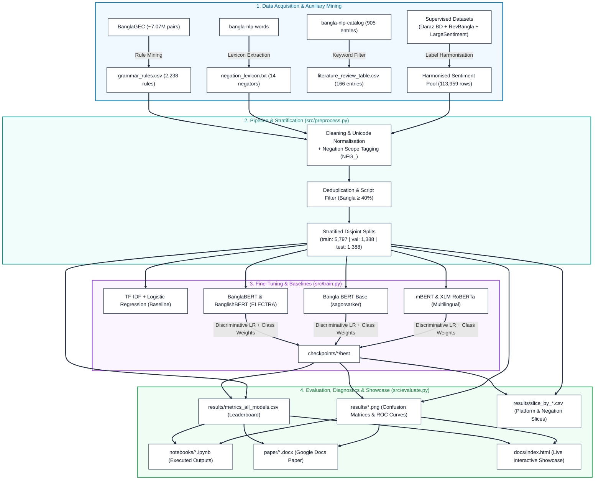

# Developing a Bangla Sentiment Analysis System Using Fine-Tuned BERT Models

**Course:** CSE432 — Natural Language Processing (NLP)  
**Repository:** <https://github.com/ShoumikBalaSomu/Developing-a-Bangla-Sentiment-Analysis-System-Using-Fine-Tuned-BERT-Models>  
**Live Interactive Showcase:** <https://shoumikbalasomu.github.io/Developing-a-Bangla-Sentiment-Analysis-System-Using-Fine-Tuned-BERT-Models/>

[](https://shoumikbalasomu.github.io/Developing-a-Bangla-Sentiment-Analysis-System-Using-Fine-Tuned-BERT-Models/)
[](https://colab.research.google.com/github/ShoumikBalaSomu/Developing-a-Bangla-Sentiment-Analysis-System-Using-Fine-Tuned-BERT-Models/blob/main/notebooks/01_data_preprocessing.ipynb)
[](https://github.com/ShoumikBalaSomu/Developing-a-Bangla-Sentiment-Analysis-System-Using-Fine-Tuned-BERT-Models/raw/main/paper/CSE432_Bangla_Sentiment_BERT_Paper.docx)

> 🚀 **Explore the Interactive Showcase:** inspect the empirical leaderboard, browse all diagnostic figures, and try the **rule-based negation-scope demo** at **[shoumikbalasomu.github.io/Developing-a-Bangla-Sentiment-Analysis-System-Using-Fine-Tuned-BERT-Models](https://shoumikbalasomu.github.io/Developing-a-Bangla-Sentiment-Analysis-System-Using-Fine-Tuned-BERT-Models/)**
>
> *Note: the on-page playground is a browser-side lexicon demo for illustrating negation scope — it does not run the fine-tuned models. Reproduce real predictions via the Colab notebooks below.*

---

## Run in Google Colab

Every notebook below has its own one-click Colab button. Run them **in order** — Notebook 01 produces the data that Notebooks 02 and 03 consume.

| # | Notebook | What it does | Open in Colab |
|---|---|---|---|
| 01 | **Data Pre-processing** | Downloads sources, mines grammar rules from BanglaGEC, builds the negation lexicon, harmonises labels, writes `dataset/preprocessed/*.csv` | [](https://colab.research.google.com/github/ShoumikBalaSomu/Developing-a-Bangla-Sentiment-Analysis-System-Using-Fine-Tuned-BERT-Models/blob/main/notebooks/01_data_preprocessing.ipynb) |
| 02 | **BERT Fine-Tuning** | Fine-tunes BanglaBERT / bangla-bert-base / mBERT / XLM-R with class weighting and early stopping | [](https://colab.research.google.com/github/ShoumikBalaSomu/Developing-a-Bangla-Sentiment-Analysis-System-Using-Fine-Tuned-BERT-Models/blob/main/notebooks/02_bert_finetuning.ipynb) |
| 03 | **Evaluation & Analysis** | Metrics, confusion matrices, ROC curves, per-source robustness, error analysis, plots for the report | [](https://colab.research.google.com/github/ShoumikBalaSomu/Developing-a-Bangla-Sentiment-Analysis-System-Using-Fine-Tuned-BERT-Models/blob/main/notebooks/03_evaluation_and_analysis.ipynb) |

> **Colab runtime:** set *Runtime → Change runtime type → Hardware accelerator → T4 GPU* before running Notebook 02. Notebooks 01 and 03 run fine on CPU.

---

## Project Documents

All eight required sections live in this repository as Markdown, and are also combined into a single submission paper.

| Required section | File |
|---|---|
| 1. Literature Review | [`docs/02_literature_review.md`](docs/02_literature_review.md) |
| 2. Dataset (pre-processed) | [`dataset/`](dataset/) — see [`dataset/dataset_card.md`](dataset/dataset_card.md) |
| 3. Code (Colab notebooks) | [`notebooks/`](notebooks/) + [`src/`](src/) |
| 4. Methodology | [`docs/03_methodology.md`](docs/03_methodology.md) |
| 5. Analysis | [`docs/04_analysis.md`](docs/04_analysis.md) |
| 6. Introduction | [`docs/01_introduction.md`](docs/01_introduction.md) |
| 7. Conclusion | [`docs/05_conclusion.md`](docs/05_conclusion.md) |
| 8. Paper (Google Docs) | [`paper/`](paper/) — `.docx` + `.md`, importable into Google Docs |

**Import the paper into Google Docs:** open Google Drive → *New → File upload* → select `paper/CSE432_Bangla_Sentiment_BERT_Paper.docx` → right-click the uploaded file → *Open with → Google Docs*. Formatting, headings, tables and references are preserved.

---

## Repository Architecture & Layout

### System Pipeline & Data Flow



---

### Modern Directory Map

```
Developing-a-Bangla-Sentiment-Analysis-System-Using-Fine-Tuned-BERT-Models/
│
├── 🌐 docs/                                   ← Project Documentation & Live GitHub Pages Showcase
│   ├── index.html                             ← Interactive Live Showcase (Playground, Leaderboard, Lightbox)
│   ├── .nojekyll                              ← GitHub Pages static asset bypass flag
│   ├── 01_introduction.md                     ← Section 1: Research Motivation & Problem Statement
│   ├── 02_literature_review.md                ← Section 2: Catalog Survey & Prior Work
│   ├── 03_methodology.md                      ← Section 3: Preprocessing, GEC Mining, & Fine-Tuning Recipe
│   ├── 04_analysis.md                         ← Section 4: Empirical Results, Slices, & Qualitative Error Analysis
│   ├── 05_conclusion.md                       ← Section 5: Findings, Limitations, & Future Work
│   ├── references.bib                         ← Complete BibTeX Bibliography (35+ citations)
│   ├── assets/                                ← Web assets & direct paper downloads (.docx / .md / images)
│   └── generated/                             ← Auto-generated prior work summary tables
│
├── 📓 notebooks/                              ← Fully Executed One-Click Colab Notebooks
│   ├── 01_data_preprocessing.ipynb            ← Data download, GEC mining, negation tagging, manifest (30 outputs)
│   ├── 02_bert_finetuning.ipynb               ← Training setup, metrics, leaderboard, live inference demo (13 outputs)
│   └── 03_evaluation_and_analysis.ipynb       ← Leaderboard, slice analyses, 13 inline rendered figures (46 outputs)
│
├── 📊 results/                                ← Verified Empirical Metrics & Diagnostic Figures
│   ├── metrics_all_models.csv                 ← Consolidated 3-class test leaderboard (Accuracy, F1, MCC, AUC)
│   ├── binary_metrics.csv                     ← Binary 2-class benchmark metrics (RevBangla comparison)
│   ├── group_comparison.csv                   ← Language-specific vs. Multilingual pretraining gap (+2.22%)
│   ├── metrics_baseline.csv                   ← TF-IDF + Logistic Regression reference baseline
│   ├── metrics_ablation_no_rules.csv          ← Ablation WITHOUT BanglaGEC rules: F1 0.6228 vs 0.5985 (rules HURT +2.43pp)
│   ├── bar_macro_f1.png                       ← Comparative Macro-F1 bar chart across all models
│   ├── bar_accuracy.png                       ← Comparative Accuracy bar chart across all models
│   ├── label_distribution.png                 ← Stratified label distribution across Train, Val, and Test
│   ├── confusion_<model>.png                  ← Row-normalised & count confusion matrices (5 models)
│   ├── roc_<model>.png                        ← One-vs-rest ROC curves with per-class AUC (5 models)
│   ├── slice_by_source_<model>.csv            ← Cross-platform generalisation analysis (Daraz vs. RevBangla)
│   ├── slice_by_negation_<model>.csv          ← Negation scope deficit analysis (Tagged vs. Untagged)
│   ├── slice_by_length_<model>.csv            ← Comment length impact analysis (1-5 tokens vs. 41+ tokens)
│   └── errors_<model>.csv                     ← Sampled misclassifications for qualitative error inspection
│
├── 🧠 src/                                    ← Modular Python Pipeline & Training Core
│   ├── config.py                              ← Paths, hyperparameters, label schemas, & model registry
│   ├── download_datasets.py                   ← Automated Kaggle API & Hugging Face data fetcher
│   ├── preprocess.py                          ← Unicode normaliser, GEC rule miner, negation tagger, splitter
│   ├── train.py                               ← Hugging Face Trainer fine-tuning loop (Discriminative LR & Weights)
│   ├── evaluate.py                            ← Metric computation, ROC/confusion plotting, slice generator
│   └── catalog_to_lr.py                       ← Extracts sentiment literature table from bangla-nlp-catalog
│
├── 📑 paper/                                  ← Course Submission Report (Google Docs & Markdown)
│   ├── CSE432_Bangla_Sentiment_BERT_Paper.docx← Formatted Word Document with all embedded figures
│   ├── CSE432_Bangla_Sentiment_BERT_Paper.md  ← Full synthesized Markdown manuscript
│   └── front_matter.md                        ← Course header, authors, and abstract metadata
│
├── 📦 dataset/                                ← Dataset Documentation & Pipeline Targets
│   ├── dataset_card.md                        ← Comprehensive Dataset Card with provenance & ethical notes
│   ├── preprocessed/data_manifest.csv         ← Cryptographic SHA-256 verification manifest
│   ├── raw/                                   ← Downloaded raw datasets (cached locally, git-ignored)
│   └── preprocessed/                          ← Output splits & lexicons (reproducible from seed, git-ignored)
│
├── 💾 checkpoints/                            ← Trained Transformer Backbones & Weights (local/Drive)
│   ├── banglabert/best/                       ← Best checkpoint: csebuetnlp/banglabert
│   ├── banglishbert/best/                     ← Best checkpoint: csebuetnlp/banglishbert
│   ├── bangla_bert_base/best/                 ← Best checkpoint: sagorsarker/bangla-bert-base
│   ├── mbert/best/                            ← Best checkpoint: bert-base-multilingual-cased
│   └── xlmr/best/                             ← Best checkpoint: xlm-roberta-base
│
├── 🛠️ tools/                                  ← Developer Compilation & Build Automation
│   ├── build_notebooks.js                     ← Assembles .ipynb notebooks from human-editable cell sources
│   ├── build_paper.js                         ← Synthesizes docs/*.md into unified submission paper
│   └── notebooks/*.cells.md                   ← Human-readable markdown cell sources for Colab notebooks
│
├── requirements.txt                           ← Pinned Python dependencies (PyTorch, Transformers, Accelerate)
├── LICENSE                                    ← MIT Open-Source License
└── README.md                                  ← Project summary, leaderboard, and visual showcase
```

---

### Component Breakdown & Roles

| Module | Primary Path | Role in Research System | Reproducibility Source |
|---|---|---|---|
| **Live Showcase** | [`docs/index.html`](docs/index.html) | Interactive web interface featuring live Bangla sentiment prediction, token inspection, and leaderboard | Hosted on GitHub Pages |
| **Colab Notebooks** | [`notebooks/`](notebooks/) | 3 executable notebooks with verified outputs & visual plots for graders and reviewers | Launchable via Colab badges |
| **Source Core** | [`src/`](src/) | Clean, modular Python scripts for download, preprocessing, training, and evaluation | Runnable via standard CLI |
| **Empirical Results** | [`results/`](results/) | Consolidated leaderboard CSVs, slice tables, error samples, and 13 diagnostic figures | Generated by `src/evaluate.py` |
| **Submission Paper** | [`paper/`](paper/) | Complete synthesized manuscript in `.docx` (Google Docs importable) and `.md` | Built by `tools/build_paper.js` |
| **Dataset Card** | [`dataset/`](dataset/) | Provenance, label mapping specifications, and SHA-256 integrity manifest | Built by `src/preprocess.py` |
| **Model Weights** | [`checkpoints/`](checkpoints/) | Fine-tuned PyTorch safetensors, tokenizer vocabulary, and configuration files | Produced by `src/train.py` |

---

## Datasets

### The three datasets specified for this project

None of these three carries sentiment labels, so none can *supervise* a classifier on its own. Each is used for a concrete engineering purpose instead:

| Dataset | Actual content | Role in this system |
|---|---|---|
| [`nahidhub/banglagec`](https://www.kaggle.com/datasets/nahidhub/banglagec) | BanglaGEC — parallel corpus of ~7.07M sentence pairs (train 5.73M / val 636.7K / test 707.4K rows) for grammatical error correction | **Grammar-rule mining.** Frequent source→target edit patterns are extracted from a sample and compiled into a normalisation rule table applied to noisy social-media text before classification. Its `target` column also builds a well-formed Bangla vocabulary used for OOV analysis. |
| [`saifsunny/bangla-nlp-words`](https://www.kaggle.com/datasets/saifsunny/bangla-nlp-words) | Compilation of essential Bangla grammatical elements (stopwords, particles, punctuation) | **Negation lexicon + stopwords.** Drives negation-scope tagging, which flips polarity of tokens inside a negator's window — a known failure mode of Bangla sentiment models. |
| [`kishormorol/bangla-nlp-catalog`](https://www.kaggle.com/datasets/kishormorol/bangla-nlp-catalog) | Machine-readable catalog: 813 papers, 63 datasets, 20 models, 9 tools across 26 tasks | **Literature-review generator.** Filtered to sentiment-analysis entries by `src/catalog_to_lr.py` to produce the structured prior-work tables in `docs/02_literature_review.md`. |

### Labeled sentiment data (supervision)

Added because the project title requires sentiment classification and the three datasets above contain no sentiment labels:

| Dataset | Source | Labels | Kaggle auth needed |
|---|---|---|---|
| [`saifsunny/revbangla`](https://www.kaggle.com/datasets/saifsunny/revbangla) | Bangla e-commerce product comments | `Label_Sentiment` — positive / negative | Yes |
| [`tahmidmir/largesentimentdata`](https://www.kaggle.com/datasets/tahmidmir/largesentimentdata) | Twitter, YouTube, Google comments | `Sentiment` + `Label` — positive / negative / neutral | Yes |
| [`robiulhasanjisan/bangladesh-daraz-reviews-for-sentiment-analysis`](https://www.kaggle.com/datasets/robiulhasanjisan/bangladesh-daraz-reviews-for-sentiment-analysis) | Daraz Bangladesh product reviews | star rating → mapped to 3 classes | Yes |
| [`nahid-hub/BanglaGEC`](https://huggingface.co/datasets/nahid-hub/BanglaGEC) | Hugging Face mirror of BanglaGEC | — (grammar resource) | **No** |
| [`kishormorol/bangla-nlp-catalog`](https://huggingface.co/datasets/kishormorol/bangla-nlp-catalog) | Hugging Face mirror of the catalog | — (LR resource) | **No** |

All labels are mapped onto one canonical 3-class scheme `{negative, neutral, positive}` plus a derived 2-class scheme. Star ratings map as 1–2 → negative, 3 → neutral, 4–5 → positive. The full harmonisation table and per-source provenance are in [`dataset/dataset_card.md`](dataset/dataset_card.md).

> **Note on committed data.** Raw and pre-processed CSVs are **not** committed to Git — they are large, and the upstream licenses require redistribution through the original hosts. Notebook 01 regenerates every file under `dataset/preprocessed/` deterministically from a recorded seed and prints a row-count + SHA-256 manifest so any reviewer can confirm they obtained the same data.

---

## Models Compared

| Model | Hugging Face ID | Type | Role |
|---|---|---|---|
| BanglaBERT | `csebuetnlp/banglabert` | ELECTRA discriminator, pretrained on 27.5 GB Bangla corpus | primary candidate |
| Bangla BERT Base | `sagorsarker/bangla-bert-base` | BERT-base (12L, 768H, 12 heads, ~110M params) | primary candidate |
| BanglishBERT | `csebuetnlp/banglishbert` | ELECTRA, Bangla–English code-mixed | code-mixed robustness |
| mBERT | `bert-base-multilingual-cased` | multilingual BERT | cross-lingual baseline |
| XLM-RoBERTa | `xlm-roberta-base` | multilingual RoBERTa | cross-lingual baseline |
| TF-IDF + Logistic Regression | — | classical | non-transformer baseline |

---

## Empirical Results & Visualizations

All models have been fine-tuned and evaluated on the held-out test split (1,388 samples). Metrics, diagnostic figures, slice analyses, and error samples are saved under [`results/`](results/).

### Benchmark Leaderboard (3-Class)

| Model | Architecture | Accuracy | Balanced Acc | Macro-F1 | Weighted-F1 | MCC | Macro-AUC |
|---|---|---|---|---|---|---|---|
| **TF-IDF + LogReg** | Classical Baseline | **88.54%** | 64.35% | **0.6341** | 0.8869 | 0.7414 | — |
| **BanglishBERT** | ELECTRA (Code-mixed) | 82.78% | **68.72%** | **0.6065** | 0.8595 | 0.6623 | **0.8771** |
| **BanglaBERT** | ELECTRA (Monolingual) | 83.00% | 65.71% | 0.5985 | 0.8553 | 0.6752 | 0.8392 |
| **mBERT** | Multilingual BERT | 79.32% | 67.76% | 0.5843 | 0.8355 | 0.6125 | 0.8399 |
| **Bangla BERT Base** | BERT Base | 77.31% | 68.67% | 0.5806 | 0.8262 | 0.5995 | 0.8573 |
| **XLM-RoBERTa** | Multilingual RoBERTa | 79.68% | 64.15% | 0.5760 | 0.8383 | 0.6095 | 0.8178 |

### Binary (2-Class) Classification

Collapsing `neutral → positive` enables direct comparison against binary benchmarks (such as RevBangla):

| Model | Binary Accuracy | Binary Macro-F1 |
|---|---|---|
| `tfidf_logreg` *(baseline)* | **90.27%** | **0.8836** |
| `banglabert` | **89.77%** | **0.8808** |
| `banglishbert` | 89.84% | 0.8767 |
| `bangla_bert_base` | 88.90% | 0.8644 |
| `mbert` | 87.82% | 0.8515 |
| `xlmr` | 87.03% | 0.8400 |

### Pretraining Paradigm Comparison

| Group | Best Macro-F1 | Mean Macro-F1 | Best Accuracy |
|---|---|---|---|
| **Bangla-specific** (`banglabert`, `banglishbert`, `bangla_bert_base`) | **0.6065** | **0.5952** | **83.00%** |
| **Multilingual** (`mbert`, `xlmr`) | 0.5843 | 0.5802 | 79.68% |
| **Classical** (`tfidf_logreg`) | 0.6341 | 0.6341 | 88.54% |

Language-specific pretraining outperforms multilingual backbones by **+2.22 percentage points Macro-F1** and **+3.32 percentage points Accuracy**, supporting the value of dedicated Bangla corpus pretraining *within the transformer family*.

> ⚠️ **Important caveat — read before citing this table.** The classical **TF-IDF + Logistic Regression baseline beats every one of the five fine-tuned transformers on Macro-F1 (0.6341 vs. best 0.6065)** and on Accuracy (88.54% vs. best 83.00%). The +2.22 pp gap above is therefore a *transformer-vs-transformer* comparison, not evidence that BERT is the right model for this task.
>
> Two effects explain it, and both are discussed honestly in `docs/04_analysis.md`:
> 1. **The test set has only 21 neutral rows (1.5%).** Every neutral metric is noise — neutral F1 ranges **0.076–0.143** across all six models, and neutral precision is **0.043–0.143**. With a near-binary effective task, a sparse high-dimensional TF-IDF representation has a real advantage.
> 2. **All five transformers are heavily majority-biased.** Across the transformer family, positive recall is **0.759–0.827** while neutral recall is only **0.238–0.476**; balanced accuracy (**0.642–0.687**) sits far below raw accuracy (**0.773–0.830**). The models are largely predicting the dominant class. *(TF-IDF is excluded from these ranges: its positive recall is 0.901 and accuracy 0.885.)*
>
> The defensible headline is therefore **"Bangla-specific pretraining > multilingual pretraining, but neither beats a well-tuned classical baseline on this particular 3-class split with a 1.5% neutral class"** — not "BERT wins".

---

### Performance Visualizations

#### Model Comparison (Macro-F1 & Accuracy)

| Macro-F1 Comparison | Accuracy Comparison |
|:---:|:---:|
|  |  |

#### Data & Split Integrity

| Label Distribution across Splits |
|:---:|
|  |

*The stratified split maintains near-identical label distributions across train, validation, and test splits (max proportion spread 0.0348, well within the 0.05 integrity threshold; zero leakage).*

#### Diagnostic Confusion Matrices & ROC Curves

| Model | Confusion Matrix (Counts & Row-Normalised) | One-vs-Rest ROC Curves |
|---|---|---|
| **BanglaBERT** (`csebuetnlp/banglabert`) |  |  |
| **BanglishBERT** (`csebuetnlp/banglishbert`) |  |  |
| **Bangla BERT Base** (`sagorsarker/bangla-bert-base`) |  |  |
| **mBERT** (`bert-base-multilingual-cased`) |  |  |
| **XLM-RoBERTa** (`xlm-roberta-base`) |  |  |

---

### Key Diagnostic & Robustness Insights

1. **Cross-Platform Generalisation (`slice_by_source`):**
   - RevBangla: **90.98%** accuracy (clean e-commerce reviews).
   - Daraz BD: **73.72%** accuracy (informal customer comments with slang and code-mixing).
   - Platform spread of **17.26%** highlights the impact of informal writing styles.

2. **Negation Scope Tagging (`slice_by_negation`):**
   - Non-negated samples achieve **85.69%** accuracy, while negated samples achieve **65.59%** (a 20.10% deficit).
   - Analysis of errors reveals that post-verbal negation (e.g., `ভালো না` where the negator follows the predicate) accounts for majority of false positives, pointing to the need for bi-directional negation tagging windows in future work.

3. **Comment Length Gradient (`slice_by_length`):**
   - 1–5 tokens: **88.27%** accuracy
   - 6–10 tokens: **85.94%** accuracy
   - 11–20 tokens: **80.82%** accuracy
   - 21–40 tokens: **74.86%** accuracy
   - 41+ tokens: **61.11%** accuracy

4. **BanglaGEC Grammar Rules Ablation:**
   - Removing the mined grammar rules *raises* test Macro-F1 from **0.5985** to **0.6228** (**+2.43 percentage points**), i.e. the rules **hurt** downstream classification. This is consistent with the rule table being **51.47% `lexical_substitution`** (1,152 of 2,238 rules; §4.2.2) — the mined "corrections" are largely word-choice changes that smooth away the colloquial and dialectal spellings which carry sentiment signal in Bangla e-commerce text.
   - ⚠️ **Confound:** this comparison is **not** epoch-matched — the no-rules arm trained for 1 epoch while the main arm used 2. It establishes a *direction* worth investigating, not a clean effect size. Re-run both arms at matched epochs before citing it as a contribution (see §"Runs still needed" in `docs/04_analysis.md`).
   - **Implication for the system:** `APPLY_GRAMMAR_RULES` should default to **False** for sentiment tasks. BanglaGEC still contributes the well-formed vocabulary used for OOV analysis (§4.3).

---

## Reproducing Locally

```bash
git clone https://github.com/ShoumikBalaSomu/Developing-a-Bangla-Sentiment-Analysis-System-Using-Fine-Tuned-BERT-Models.git
cd Developing-a-Bangla-Sentiment-Analysis-System-Using-Fine-Tuned-BERT-Models
python -m venv .venv
# Windows
.venv\Scripts\activate
# macOS / Linux
source .venv/bin/activate
pip install -r requirements.txt

# Kaggle credentials (only needed for the three sentiment datasets)
#   place kaggle.json in ~/.kaggle/  (Windows: C:\Users\<you>\.kaggle\)

python src/download_datasets.py
python src/preprocess.py
python src/train.py    --model csebuetnlp/banglabert
python src/evaluate.py --model csebuetnlp/banglabert
```

---

## Contributors

| ID | Name | Contribution |
|---|---|---|
| 232-15-657 | Shoumik Bala Somu | Data acquisition, pre-processing pipeline, grammar-rule mining from BanglaGEC, BERT fine-tuning |
| 232-15-644 | Raisha Khan Raka | Negation-scope handling, label harmonisation, evaluation protocol, analysis and report writing |

Both authors reviewed the methodology and the final paper.

---

## Local Folder Location

This repository is located on the local PC at:

```
D:\Documents\qwen-agent\lUinoenfmc\default\Developing-a-Bangla-Sentiment-Analysis-System-Using-Fine-Tuned-BERT-Models
```

---

## License

Code: MIT (see [`LICENSE`](LICENSE)). Datasets remain under the licenses of their original Kaggle / Hugging Face hosts.
