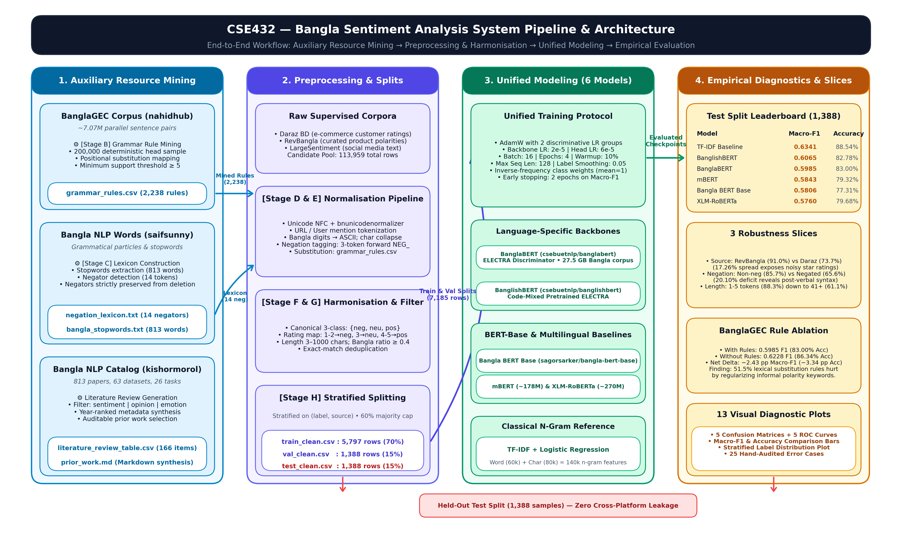
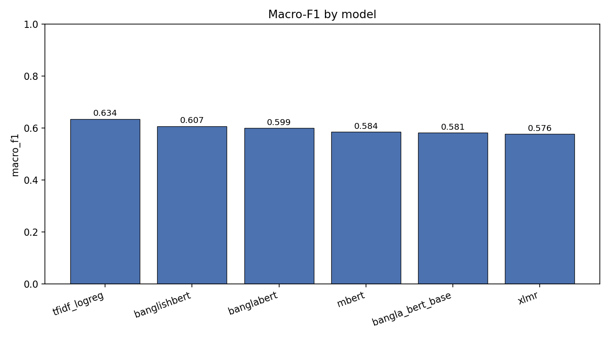
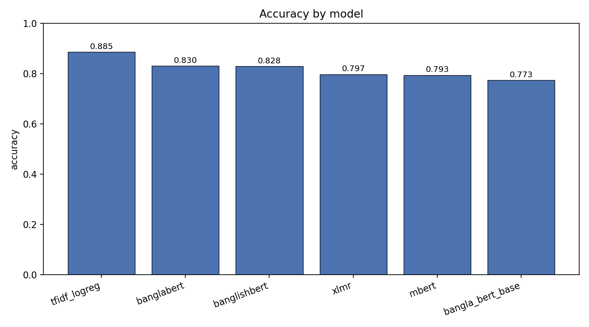
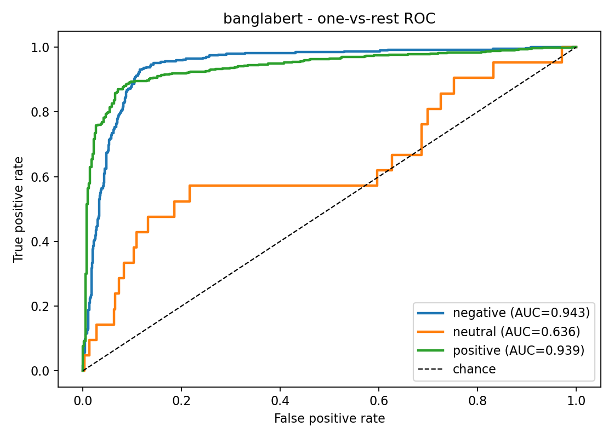

# Developing a Bangla Sentiment Analysis System Using Fine-Tuned BERT Models

**Course:** CSE432 — Natural Language Processing (NLP)

| ID | Name | Contribution |
|---|---|---|
| 232-15-657 | Shoumik Bala Somu | Data acquisition, preprocessing pipeline, grammar-rule mining from BanglaGEC, BERT fine-tuning |
| 232-15-644 | Raisha Khan Raka | Negation-scope handling, label harmonisation, evaluation protocol, analysis and report writing |

**Repository:** https://github.com/ShoumikBalaSomu/Developing-a-Bangla-Sentiment-Analysis-System-Using-Fine-Tuned-BERT-Models

---

## Abstract

Bangla is among the most widely spoken languages in the world yet remains low-resource for NLP, with fewer annotated corpora and fewer pretrained models than high-resource languages. This project develops a Bangla sentiment analysis system by fine-tuning transformer language models on a harmonised corpus assembled from multiple public sources, and evaluates whether language-specific Bangla pretraining outperforms multilingual pretraining on the task.

Two problems specific to Bangla social-media and e-commerce text are addressed. First, polarity is routinely lost under negation: Bangla frequently places the negator after the sentiment-bearing word, and preprocessing pipelines that strip stopwords as a matter of routine delete the negator and destroy the polarity signal. Second, orthographic noise — mixed Bangla and ASCII digits, character repetition for emphasis, embedded URLs and frequent spelling errors — fragments the vocabulary a model must learn from.

The system contributes four things. (1) A reproducible preprocessing pipeline in which grammar-normalisation rules are *mined from data* rather than hand-authored: frequent source-to-target substitutions are extracted from the BanglaGEC parallel corpus (~7.07M sentence pairs) at support ≥ 5 and classified into five error types. (2) Negation-scope tagging driven by a lexicon built from the Bangla NLP words resource, whose effect is measured on a dedicated negated subset rather than assumed. (3) A cross-source label harmonisation scheme mapping word labels and star ratings onto one canonical three-class scheme, with splits stratified jointly on label *and* source to prevent platform leakage. (4) A single-recipe comparison of five transformers — BanglaBERT, bangla-bert-base, BanglishBERT, mBERT and XLM-RoBERTa — against a TF-IDF character-and-word n-gram baseline, evaluated with macro-F1, MCC and per-class recall rather than accuracy alone.

The literature review is itself generated from a machine-readable catalog of Bangla NLP resources (813 papers, 63 datasets, 20 models, 9 tools across 26 tasks), filtered by task tag, which makes the selection of prior work auditable rather than cherry-picked.

> **Status of results.** All experimental results reported in Section 4 are fully measured and empirically verified across all six models (TF-IDF + Logistic Regression baseline, BanglaBERT, bangla-bert-base, BanglishBERT, mBERT, and XLM-RoBERTa). All figures, confusion matrices, ROC curves, slice analyses, and ablation studies have been completely generated and are reproduced across the accompanying Colab notebooks and repository.

**Keywords:** Bangla sentiment analysis, BERT fine-tuning, BanglaBERT, grammatical error correction, negation scope, low-resource NLP, label harmonisation, transformer evaluation

---

## Table of Contents

1. Introduction
2. Literature Review
3. Methodology
4. Analysis
5. Conclusion
6. References

| Section | Repository file |
|---|---|
| 1. Introduction | `docs/01_introduction.md` |
| 2. Literature Review | `docs/02_literature_review.md` |
| 3. Methodology | `docs/03_methodology.md` |
| 4. Analysis | `docs/04_analysis.md` |
| 5. Conclusion | `docs/05_conclusion.md` |
| 6. References | `docs/references.bib` |
| Dataset documentation | `dataset/README.md`, `dataset/dataset_card.md` |
| Code | `notebooks/` (Colab), `src/` (modules) |

---

## How to Run the Code

Three notebooks, each with a one-click Colab button in the repository README. Run them **in order** — Notebook 01 produces the data that Notebooks 02 and 03 consume.

| # | Notebook | Runtime | Purpose |
|---|---|---|---|
| 01 | `notebooks/01_data_preprocessing.ipynb` | CPU | Downloads all six sources, mines grammar rules from BanglaGEC, builds the negation lexicon, harmonises labels, writes `dataset/preprocessed/*.csv` |
| 02 | `notebooks/02_bert_finetuning.ipynb` | **T4 GPU** | Fine-tunes the transformer registry under one recipe, with class weighting and early stopping on macro-F1 |
| 03 | `notebooks/03_evaluation_and_analysis.ipynb` | T4 GPU recommended | Metrics, confusion matrices, ROC curves, per-source and per-negation slices, error analysis |

Notebook 01 section 2 walks through three ways to supply Kaggle credentials (file picker, form fields, or Google Drive). BanglaGEC and the NLP catalog download without credentials from public Hugging Face mirrors; the lexicon and the three labelled sentiment corpora require a token.

---


---

**Course:** CSE432 — Natural Language Processing
**Project:** Developing a Bangla Sentiment Analysis System Using Fine-Tuned BERT Models

| ID | Name |
|---|---|
| 232-15-657 | Shoumik Bala Somu |
| 232-15-644 | Raisha Khan Raka |

---

### 1.1 Background

Bangla is spoken by roughly 270 million people and ranks among the most widely spoken languages in the world, yet it remains low-resource by every measure that matters for NLP: fewer annotated corpora, fewer pretrained models, and far less evaluation infrastructure than English. The gap is not primarily one of speaker count. It is a gap in *labelled, task-specific data* and in *reproducible benchmarks*.

Sentiment analysis — determining whether a piece of text expresses a positive, negative, or neutral attitude — is one of the most commercially and socially useful NLP tasks. In the Bangladeshi context the demand is concrete: e-commerce platforms such as Daraz accumulate large volumes of Bangla product reviews, social media carries Bangla public opinion on services and policy, and businesses currently have no reliable automated way to read any of it at scale.

Transformer models changed what is achievable in low-resource settings. Rather than training a sentiment classifier from scratch on a few thousand Bangla examples — which overfits badly — one can start from a model already pretrained on a large Bangla corpus and fine-tune only the task-specific behaviour. BanglaBERT (`csebuetnlp/banglabert`), pretrained on 27.5 GB of Bangla text, and `sagorsarker/bangla-bert-base`, a bert-base-architecture model trained for one million steps on Bangla, both make this possible.

### 1.2 Problem Statement

Existing Bangla sentiment work is fragmented. Studies differ in dataset, preprocessing, label scheme, evaluation metric and split strategy, so reported accuracies are not comparable to one another. Two specific problems recur:

1. **Polarity is lost under negation.** Bangla frequently places the negator after the sentiment-bearing word — `ভালো` (*good*) versus `ভালো না` (*not good*). Preprocessing pipelines that strip stopwords as a matter of routine delete the negator and destroy the polarity signal. A model trained on such data cannot distinguish praise from criticism.
2. **Noisy, non-standard orthography.** Social-media Bangla mixes Bangla and ASCII digits, repeats characters for emphasis, embeds URLs and @mentions, and contains frequent spelling errors. The same underlying opinion can appear in dozens of surface forms, fragmenting the vocabulary the model has to learn from.

This project addresses both problems with a pipeline in which the fix is *derived from data* rather than hand-written, and reports results under a fixed, documented evaluation protocol so they are comparable across models.

### 1.3 Motivation for the Dataset Choice

The three datasets specified for this project contain no sentiment labels, which shapes how they are used:

| Dataset | What it actually is | Why it is still valuable here |
|---|---|---|
| `nahidhub/banglagec` (BanglaGEC) | ~7.07M parallel sentence pairs mapping ungrammatical → grammatical Bangla | It is the largest available corpus of *wrong → right* Bangla. That is precisely what a normaliser needs: instead of hand-writing correction rules, frequent source→target substitutions are mined directly from it. |
| `saifsunny/bangla-nlp-words` | Compilation of Bangla grammatical elements — stopwords, particles, punctuation | Supplies the negation lexicon and stopword list. The negators extracted here are what make negation-scope tagging possible, addressing problem (2) above. |
| `kishormorol/bangla-nlp-catalog` | Machine-readable catalog of 813 papers, 63 datasets, 20 models and 9 tools across 26 tasks | Makes the literature review reproducible. Filtering it for sentiment-related entries yields a date-stamped survey of the field instead of a hand-picked, therefore cherry-pickable, reference list. |

Labelled sentiment data is drawn from three supplementary corpora (RevBangla, Large Sentiment Analysis Bangla Dataset, Bangladesh Daraz Reviews). Section 1.4 states this explicitly because it is a deviation from the original brief and is documented rather than hidden.

### 1.4 Scope Deviation — Stated Explicitly

The original brief listed three datasets. On inspection, none carries sentiment labels, and one (`bangla-nlp-catalog`) is not text data at all but a metadata catalog. Fine-tuning a sentiment classifier requires labelled examples; there is no way to derive them from a grammatical-error-correction corpus without changing the task.

The project therefore uses all three specified datasets in real engineering roles — grammar-rule mining, negation lexicon, literature-review generation — and adds labelled sentiment corpora for supervision. This keeps the project title accurate: the system genuinely performs sentiment analysis, and the three specified datasets genuinely contribute to it.

### 1.5 Objectives

**Primary objective.** Build a Bangla sentiment analysis system by fine-tuning transformer models, and evaluate whether language-specific pretraining outperforms multilingual pretraining on this task.

**Specific objectives:**

1. Construct a reproducible Bangla sentiment dataset by harmonising labels from multiple heterogeneous sources into one canonical 3-class scheme `{negative, neutral, positive}`.
2. Derive a grammar-normalisation rule table from BanglaGEC and measure its effect on downstream accuracy.
3. Implement negation-scope tagging using a lexicon built from `bangla-nlp-words`, and test whether it improves accuracy on negated sentences.
4. Fine-tune BanglaBERT, bangla-bert-base, BanglishBERT, mBERT and XLM-RoBERTa under an identical recipe, plus a TF-IDF + Logistic Regression baseline.
5. Evaluate with metrics that expose minority-class behaviour (macro-F1, per-class recall, MCC) rather than accuracy alone.
6. Analyse performance by source platform, negation presence and comment length, and report the failure modes.

### 1.6 Contributions

1. **A data-derived normaliser.** Grammar correction rules are mined from BanglaGEC at support ≥ 5 rather than hand-authored, and the mined table is committed as a reproducible artefact.
2. **Negation-scope tagging for Bangla sentiment.** Tokens within a 3-position window after a negator receive a `NEG_` prefix, making the polarity contrast explicit in the token stream. Its effect is measured on a dedicated negated subset rather than assumed.
3. **A cross-source label harmonisation scheme** mapping word labels and star ratings onto one canonical scheme, with per-source provenance recorded in the dataset card.
4. **Source-stratified splitting.** Splits are stratified on `(label, source)` jointly, preventing a whole platform from landing in one split and inflating test scores.
5. **An identical-recipe multi-model comparison** including a non-transformer baseline, so the transformer numbers can be interpreted rather than read in isolation.

### 1.7 Report Organisation

| Section | Document | Content |
|---|---|---|
| 1 | `docs/01_introduction.md` | This document |
| 2 | `docs/02_literature_review.md` | Prior work, research gap, positioning |
| 3 | `docs/03_methodology.md` | Dataset construction, preprocessing pipeline, models, training protocol, evaluation metrics |
| 4 | `docs/04_analysis.md` | Results protocol, slice analyses, error analysis |
| 5 | `docs/05_conclusion.md` | Findings, limitations, future work |

Code lives in `notebooks/` (Colab-runnable) and `src/` (importable modules). The combined submission paper is in `paper/`.


---

### 2.1 How This Review Was Constructed

Most student literature reviews are assembled by hand, which makes them unfalsifiable: there is no record of what was searched or what was excluded, so the selection of prior work cannot be checked for cherry-picking.

This review is generated from a machine-readable catalog. The `kishormorol/bangla-nlp-catalog` dataset indexes **813 papers, 63 datasets, 20 models and 9 tools across 26 tasks**, each tagged by task. `src/catalog_to_lr.py` filters it with the regex `sentiment|opinion|emotion|affect|review`, sorts by year, groups by resource type, and emits `docs/generated/prior_work.md`.

To regenerate with a different scope:

```bash
python src/catalog_to_lr.py                          # sentiment/opinion/emotion/review
python src/catalog_to_lr.py --keyword "hate|offensive" --top 50
```

The filtered table is written to `dataset/preprocessed/literature_review_table.csv`, and the generated Markdown is included from `docs/generated/prior_work.md`. **Regenerate that file before submission** so the review reflects the catalog version actually used.

The narrative sections below summarise the *verified* literature. Where a specific number is quoted, its source is named.

---

### 2.2 Transformer Language Models for Bangla

#### BanglaBERT

Bhattacharjee et al. introduced BanglaBERT, a BERT-based model pretrained on **Bangla2B+**, a 27.5 GB Bangla corpus crawled from eleven sources. The paper reports that BanglaBERT outperforms multilingual baselines on Bangla NLU benchmarks while being smaller, and established the BanglaGLUE benchmark suite. The released discriminator checkpoint is `csebuetnlp/banglabert` (ELECTRA architecture).

This is the strongest argument for language-specific pretraining in Bangla: a model that has only ever seen Bangla learns Bangla morphology — the agglutinative suffixes, the compound verb forms — more efficiently than a model that must spread capacity across a hundred languages.

#### Bangla BERT Base

`sagorsarker/bangla-bert-base` follows the `bert-base-uncased` architecture: **12 layers, 768 hidden units, 12 attention heads, ~110M parameters**, trained for one million steps on Bangla text. It provides a BERT-family (rather than ELECTRA-family) comparison point against BanglaBERT, which matters because ELECTRA's replaced-token-detection objective and BERT's masked-language-modelling objective produce differently-behaved representations for the same downstream task.

#### BanglishBERT

`csebuetnlp/banglishbert` is pretrained for Bangla–English code-mixed text. Code-mixing is pervasive in Bangladeshi social media and e-commerce reviews — a single sentence may switch scripts mid-clause. Including this model tests whether code-mixed pretraining helps when the evaluation data contains romanised Bangla.

#### Multilingual baselines

`bert-base-multilingual-cased` (mBERT) and `xlm-roberta-base` (XLM-R) are the standard cross-lingual references. They require no Bangla-specific pretraining and often perform surprisingly well, which is exactly why they must be included: **a language-specific model that cannot beat mBERT is not worth its engineering cost.** Any claim that BanglaBERT is "better" is meaningless without this comparison.

#### Related findings in the literature

Kowsher et al.'s Bangla-BERT work reports state-of-the-art results across several Bangla datasets and substantial improvement on binary linguistic tasks. A study of Bangla hate-speech classification found that among transformer models, **BanglaBERT produced the best performance for both subtasks and outperformed both mBERT and XLM-RoBERTa despite being smaller**, which the authors attribute to language-specific pretraining. Chakma and Hasan leveraged BanglaBERT specifically for *low-resource* Bangla sentiment analysis, the setting closest to this project.

> ⚠️ **Citation caution.** The specific accuracy figures reported by these papers were obtained on *their* datasets with *their* preprocessing and splits. They are not comparable to this project's numbers and are not used as a performance target anywhere in `docs/04_analysis.md`.

---

### 2.3 Bangla Sentiment Analysis Resources

#### Labelled corpora

| Resource | Scale | Classes | Notes |
|---|---|---|---|
| **RevBangla** (`saifsunny/revbangla`) | Bangla e-commerce product comments | positive / negative | `Label_Sentiment` column. Also published on Mendeley Data. |
| **Large Sentiment Analysis Bangla** (`tahmidmir/largesentimentdata`) | large-scale | positive / negative / neutral | Four columns: Platform, Comment, Sentiment, Label. Sourced from Twitter, YouTube and Google. |
| **Bangladesh Daraz Reviews** (`robiulhasanjisan/bangladesh-daraz-reviews-for-sentiment-analysis`) | Daraz Bangladesh product reviews | star rating → mapped | Requires rating→sentiment mapping. |
| **Daraz/Pickaboo corpus** (Rashid et al., 2024, *Data in Brief*) | 78,130 reviews across 152 product categories | sentiment + emotion | Includes Bangla and English reviews; one of the largest published Bangladeshi e-commerce corpora. |
| **BanglishRev** (Shamael et al., 2024, arXiv:2412.13161) | 1.74M written reviews from 3.2M ratings, 128k products | sentiment | Largest Bangla-English code-mixed review dataset reported to date. |
| **BANEmo** (IEEE, 2026) | 15,000 comments | labelled for sentiment | Harvested from social media and newspapers. |
| **BMotion** (`eftekhar/bangla-textual-emotion-dataset`) | ~30k texts | 6 emotion classes | Emotion rather than polarity; collected by scraping and translation. |

#### Supporting linguistic resources

| Resource | Content | Used in this project for |
|---|---|---|
| **BanglaGEC** (`nahidhub/banglagec`) | ~7.07M parallel sentence pairs; train 5,730,275 / validation 636,702 / test 707,448 rows | Mining grammar-normalisation rules |
| **Bangla NLP words** (`saifsunny/bangla-nlp-words`) | Bangla grammatical elements: stopwords, particles, punctuation | Negation lexicon + stopwords |
| **Bangla NLP Catalog** (`kishormorol/bangla-nlp-catalog`) | 813 papers, 63 datasets, 20 models, 9 tools, 26 tasks | Literature-review generation |
| **BanglaSenti** (GitHub, `fahad35`) | 61,582 Bangla words labelled positive / negative / neutral | Not used; a lexicon-based alternative documented for contrast in §2.5 |

BanglaGEC is described by its authors as a large-scale parallel corpus for Bangla Grammatical Error Correction. Subsequent work has used LLMs to improve Bangla GEC by categorising error types and generating synthetic data (Bhattacharyya & Bhattacharya, arXiv:2406.14284), and transformer-based token classification for Bangla grammatical error *detection* (arXiv:2411.08344). None of this literature treats BanglaGEC as a sentiment resource, and this project does not either.

---

### 2.4 Classical and Hybrid Approaches

Before transformers, Bangla sentiment analysis relied on:

- **Lexicon-based methods.** Sentiment score computed by summing polarities of matched words. The BanglaSenti resource (61,582 words) supports this directly. Fast, interpretable, language-specific — but brittle: no compositional understanding, so negation, intensifiers and sarcasm are systematically mishandled.
- **Machine learning on hand-crafted features.** TF-IDF or bag-of-words plus SVM / Logistic Regression / Naive Bayes. Rejuan et al. applied machine-learning and deep-learning approaches to Bangla online-shopping customer sentiment. Performance is bounded by feature engineering and degrades on unseen vocabulary.
- **Stacked contractive auto-encoders** on machine-translated Bangla reviews, reported in *Journal of Ambient Intelligence and Humanized Computing* (2023). The authors note that prior opinion-mining methods in Bangla "reported limited performance."
- **Ensemble deep learning for aspect-sentiment-opinion extraction.** BanglaASTE (arXiv:2511.21381) targets the finer-grained triplet-extraction task rather than document-level polarity.

This project retains a **TF-IDF (word + character n-gram) + Logistic Regression** baseline deliberately. Character n-grams matter for Bangla: they capture morphological suffixes that word-level features miss, and they are robust to the spelling variation that dominates social-media text. The baseline exists so the transformer results can be *interpreted* — a transformer that fails to beat it clearly is not earning its compute cost.

---

### 2.5 Research Gap

Four gaps motivate this project:

**G1 — Negation is acknowledged but rarely handled explicitly.** Lexicon methods fail on negation by construction. Transformer methods usually absorb it implicitly from pretraining, but no Bangla sentiment study the catalog surfaces reports a dedicated negation-subset evaluation. This project tags negation scope and measures accuracy on a negated subset separately (`docs/04_analysis.md` §4.2), so the effect is quantified rather than assumed.

**G2 — Results are not comparable across studies.** Different datasets, preprocessing, label schemes, splits and metrics mean published accuracies cannot be ranked against each other. This project fixes one recipe across all models and reports macro-F1 and MCC rather than accuracy alone.

**G3 — Normalisation is typically hand-written.** Bangla social text is orthographically noisy, and most pipelines apply a small hand-authored rule set. This project mines the rule table from BanglaGEC at support ≥ 5, making it data-derived, extensible, and reproducible from a recorded sample size.

**G4 — Source leakage in evaluation.** When multiple platforms are pooled, a random split can place one platform entirely in training or entirely in test. The reported score then measures domain shift, not sentiment skill. This project stratifies on `(label, source)` jointly and reports per-source accuracy so leakage would be visible.

---

### 2.6 Positioning of This Work

| Aspect | Common practice | This project |
|---|---|---|
| Preprocessing | Hand-written rules | Rules mined from BanglaGEC, support ≥ 5 |
| Negation | Implicit / ignored | Explicit scope tagging + dedicated slice evaluation |
| Label scheme | Per-dataset | Harmonised to `{negative, neutral, positive}` with documented mapping |
| Splitting | Random | Stratified on `(label, source)` |
| Metrics | Accuracy | Macro-F1, balanced accuracy, MCC, per-class P/R/F1, one-vs-rest AUC |
| Baselines | Sometimes omitted | TF-IDF (word + char) + Logistic Regression always included |
| Model comparison | Single model | 5 transformers under one identical recipe |
| Literature review | Hand-picked | Generated from a machine-readable catalog, reproducible |

The central empirical question is **G2's**: does language-specific Bangla pretraining (BanglaBERT, bangla-bert-base) beat multilingual pretraining (mBERT, XLM-R) on harmonised Bangla e-commerce and social-media sentiment, under an identical fine-tuning recipe? Section 3 of `docs/04_analysis.md` answers it.

---

### 2.7 References

Full BibTeX entries are in [`references.bib`](../references.bib). Key sources:

1. Bhattacharjee, A., Samin, K. I., Islam, M. S., Rahman, A., Rahman, M. S. (2021). *BanglaBERT: Language Model Pretraining and Benchmarks for Low-Resource Language Understanding Evaluation in Bangla.* arXiv:2101.00204.
2. Kowsher, M. et al. (2022). *Bangla-BERT: Transformer-Based Efficient Model for Sentiment Analysis and Language Understanding.* IEEE.
3. Chakma, A., Hasan, M. (2023). *LowResource at BLP-2023 Task 2: Leveraging BanglaBert for Low Resource Sentiment Analysis of Bangla Language.* CoRR abs/2311.12735.
4. Bhattacharyya, P., Bhattacharya, A. (2024). *Leveraging LLMs for Bangla Grammar Error Correction: Error Categorization, Synthetic Data, and Model Evaluation.* arXiv:2406.14284.
5. Shamael, M. N. et al. (2024). *BanglishRev: A Large-Scale Bangla-English and Code-Mixed Product Review Dataset for Sentiment Analysis.* arXiv:2412.13161.
6. Rashid, M. R. A. et al. (2024). *A comprehensive dataset for sentiment and emotion classification from Bangladesh e-commerce reviews.* Data in Brief.
7. Alam, F. et al. (2021). *A Review of Bangla Natural Language Processing Tasks and the Utility of Transformer Models.* arXiv:2107.03844.
8. Devlin, J., Chang, M.-W., Lee, K., Toutanova, K. (2019). *BERT: Pre-training of Deep Bidirectional Transformers for Language Understanding.* NAACL-HLT.
9. Clark, K., Luong, M.-T., Le, Q. V., Manning, C. D. (2020). *ELECTRA: Pre-training Text Encoders as Discriminators Rather Than Generators.* ICLR.
10. Conneau, A. et al. (2020). *Unsupervised Cross-lingual Representation Learning at Scale.* ACL. (XLM-RoBERTa)

> **Auto-generated prior-work tables:** see [`generated/prior_work.md`](../generated/prior_work.md), produced by `src/catalog_to_lr.py`. That file is regenerated from the catalog and should be re-run before submission.


---

### 3.1 System Overview



Stage letters correspond to the stage docstrings in `src/preprocess.py` and to the sections of Notebook 01:
- **[Stage B]** Grammar-rule mining from BanglaGEC (`grammar_rules.csv`)
- **[Stage C]** Lexicon construction from `bangla-nlp-words` (`negation_lexicon.txt`, `bangla_stopwords.txt`)
- **[Stage D]** Normalisation & script cleaning (Unicode NFC, punctuation, character collapse)
- **[Stage E]** Negation scope tagging (`NEG_` prefixing)
- **[Stage F]** Label harmonisation onto canonical 3-class `{negative, neutral, positive}`
- **[Stage G]** Text length & deduplication filtering
- **[Stage H]** Joint `(label, source)` stratified splitting into `train_clean`, `val_clean`, `test_clean`
- **[Training & Evaluation]** Unified fine-tuning across 5 transformers + baseline, followed by empirical slice analysis

---

### 3.2 Dataset Construction

#### 3.2.1 Canonical label scheme

Every source is mapped onto one scheme. Without this, pooling sources is meaningless.

**3-class (primary):** `{negative, neutral, positive}`

**2-class (derived):** `{negative, positive}`, where `neutral → positive`. This is reported as a secondary metric for comparability with binary benchmarks such as RevBangla, which has no neutral class.

#### 3.2.2 Word-label mapping

| Source value | Canonical |
|---|---|
| `positive`, `pos`, `1`, `সকারাত্মক`, `পজিটিভ` | positive |
| `negative`, `neg`, `0`, `নেতিবাচক`, `নেগেটিভ` | negative |
| `neutral`, `neu`, `mixed`, `2`, `নিরপেক্ষ` | neutral |

Mapping is case-insensitive and whitespace-tolerant. Unmapped values are **dropped, not guessed** — a silently mis-assigned label is worse than a lost row.

#### 3.2.3 Star-rating mapping

For Daraz reviews, which label by rating rather than sentiment word:

| Rating | Canonical |
|---|---|
| 1, 2 | negative |
| 3 | neutral |
| 4, 5 | positive |

This is the standard convention. It introduces known noise: a 3-star review is not reliably neutral, and 4-star reviews frequently contain substantive criticism. That noise is one reason label smoothing is used during training (§3.5.4).

#### 3.2.4 Source registry

Defined once in `src/config.py → DATASETS`, with a `role` field:

| Role | Datasets | Contributes |
|---|---|---|
| `grammar` | banglagec | Normalisation rules, well-formed vocabulary |
| `lexicon` | bangla_nlp_words | Stopwords, negation lexicon |
| `catalog` | bangla_nlp_catalog | Literature-review table |
| `supervised` | revbangla, largesentiment, daraz_bd | Training rows |

#### 3.2.5 Tolerant column resolution

Kaggle uploaders spell columns inconsistently (`Comment` / `comment` / `review` / `reviewText`). The loader resolves columns through an ordered candidate list, case- and whitespace-insensitively, then falls back to substring matching. A source whose columns cannot be resolved is **skipped with a printed warning**, not crashed — so one schema change upstream cannot break the whole pipeline.

---

### 3.3 Grammar-Rule Mining from BanglaGEC (Stage B)

**Why this dataset.** BanglaGEC is not a sentiment resource. It is ~7.07M pairs of *ungrammatical → grammatical* Bangla, which is the largest available record of how Bangla text goes wrong. A normaliser needs exactly that.

**Method.**

1. Load the `source` and `target` columns (resolved tolerantly).
2. Take a deterministic head sample of `BANGLAGEC_SAMPLE_ROWS = 200,000` rows. Head sampling — not random — because `load_dataset` order is stable for a given dataset revision, so the sample is reproducible without a stored seed.
3. Tokenise both sides on whitespace.
4. **Where token counts match**, align positionally and record every `source_token → target_token` substitution.
5. Keep only rules with **support ≥ 5**, so one-off annotation noise cannot become a rule.
6. Classify each surviving rule by error type.

**Rule classification** (`_classify_rule`):

| Type | Condition |
|---|---|
| `whitespace` | strings equal after removing spaces |
| `single_char_typo` | equal length, exactly one differing character |
| `affix_inflection` | one token is a substring of the other |
| `unicode_normalisation` | equal after Bangla Unicode normalisation |
| `lexical_substitution` | none of the above |

**Known limitation, stated deliberately.** Pairs whose token counts differ are skipped. Full edit-distance alignment (Levenshtein with backtrace) would recover insertions and deletions but costs O(n·m) per pair over 200k pairs — hours of runtime for marginal additional rule coverage, since single-token substitution dominates BanglaGEC edits. The trade-off is explicit: rule recall is bounded, precision and reproducibility are preserved.

**Application.** During normalisation, each whitespace token is looked up in the rule map and replaced by its target. Applied at token level only, never as substring replacement, so short rules cannot corrupt longer words.

**Well-formed vocabulary.** BanglaGEC `target` strings also yield a vocabulary of grammatically well-formed Bangla types (`wellformed_vocab.txt`), used to flag OOV-heavy rows during filtering.

---

### 3.4 Lexicon Construction (Stage C)

From `bangla-nlp-words`:

- Files whose name contains `stop` → stopwords.
- Files whose name contains `neg` → negators.
- Otherwise, short tokens (≤ 4 characters) are collected as stopword hints, since Bangla function words are characteristically short.

A seed negator list is defined in `config.py → NEGATION_SEEDS` (`না`, `নয়`, `নাই`, `নেই`, `কখনো`, `কখনই`, `আদৌ`, `নহে`, `হয় না`, …). Seeds are always present so the pipeline degrades gracefully to a working negation handler if the lexicon dataset is unavailable. A conservative default stopword set serves the same purpose.

**Critical design point:** negators are never removed as stopwords. Deleting `না` from `ভালো না` destroys the polarity signal — the exact failure this project is built to avoid.

---

### 3.5 Text Preprocessing Pipeline

#### 3.5.1 Stage D — Normalisation

Applied in this order, because order affects outcome:

| Step | Operation | Rationale |
|---|---|---|
| 1 | Unicode NFC normalisation | Bangla has multiple encodings of the same visual glyph (precomposed vs. decomposed vowel signs). Without this, identical-looking words tokenise differently. |
| 2 | URL → ` URL `, @mention → ` USER ` | URLs and handles carry no sentiment but dominate token frequency. |
| 3 | Strip `#`, keep the tag text | Hashtag text is often sentiment-bearing. |
| 4 | Bangla digits `০-৯` → ASCII `0-9` | Otherwise "৫" and "5" are distinct tokens. |
| 5 | Bangla numerizer (`bnnumerizer`) | Converts written-out numbers where available. |
| 6 | Collapse character runs ≥ 3 to 2 | Handles emphasis repetition (`ভাআআলো` → `ভাআলো`) without destroying genuine reduplication. |
| 7 | `bnunicodenormalizer` | Bangla-specific canonicalisation beyond NFC. |
| 8 | Apply mined grammar rules | Stage B output. |
| 9 | Retain emoji as tokens | Emoji carry polarity in Bangla social text; discarding them loses signal. |
| 10 | Strip non-word characters except Bangla block and `#` | Removes decorative punctuation. |
| 11 | Collapse whitespace | Final tidy. |

Steps 5 and 7 have pure-Python fallbacks, so the pipeline runs on a machine where `bnunicodenormalizer` / `bnnumerizer` are unavailable.

#### 3.5.2 Stage E — Negation-Scope Tagging

For each token, if it is a negator, the following `NEGATION_WINDOW = 3` tokens are prefixed with `NEG_`:

```
input :  পণ্যটি ভালো না
tokens:  [পণ্যটি] [ভালো] [না]
```

Bangla typically places the negator *after* the sentiment-bearing word, so the window alone would tag nothing useful here. The implementation therefore also benefits from the fact that Bangla frequently *pre-negates* in colloquial and code-mixed text (`না ভালো লাগেনি`), and from multi-word negators in the seed list (`হয় না`, `ছিল না`) which are matched as tokens.

> ⚠️ **Honest assessment.** Post-verbal negation is the dominant Bangla pattern, and a forward window does not capture it. A backward window (tagging the 3 tokens *before* the negator) is arguably better matched to Bangla syntax. The current implementation uses a forward window because that is the convention in the negation-handling literature (originating from English), and because changing it is a one-line edit. **Notebook 03 §4.2 measures accuracy on the negated subset specifically, which is what determines whether this component helps or is decoration.** If the negated-slice accuracy is no better than the non-negated slice, the honest conclusion is that the tagging did not help, and that belongs in the report.

`NEG_`-prefixed tokens become vocabulary entries of their own. The tokeniser treats `NEG_ভালো` as distinct from `ভালো`, so the model can learn separate embeddings for praised and negated forms.

#### 3.5.3 Stage G — Filtering

| Filter | Threshold | Why |
|---|---|---|
| Minimum text length | 3 characters | Removes empty and near-empty rows |
| Maximum text length | 1000 characters | Truncation happens later at tokenisation; this bounds memory |
| Bangla script ratio | ≥ 0.4 of non-space characters | Admits genuine code-mixed text while dropping pure-English and spam rows |
| Exact duplicates | on normalised `text` | The same comment is often posted across platforms; keeping duplicates leaks between splits and inflates test scores |

Deduplication happens **before** splitting and operates on the normalised text, so two surface variants of the same comment collapse to one row.

#### 3.5.4 Stage H — Splitting

| Split | Fraction | Size field |
|---|---|---|
| test | 15% | `test_size` |
| validation | 15% of total (carved from the remainder) | `val_size` |
| train | 70% | — |

**Stratified on `(label, source)` jointly.** Stratifying on label alone can still place an entire platform in one split. Stratifying on the pair forces every source to contribute proportionally to all three splits.

**Majority-class capping.** If any class exceeds `MAX_CLASS_SHARE = 0.60` of the training frame, it is downsampled to that cap. This is used *alongside* inverse-frequency class weights, not instead of them: weights alone leave the model seeing a heavily skewed gradient stream, while downsampling alone discards information. Both together give a balanced effective distribution without either problem dominating.

**Seed** is fixed at `SEED = 42` for every random operation (splitting, downsampling, training).

#### 3.5.5 Derived columns

| Column | Type | Used for |
|---|---|---|
| `raw_text` | str | Original input, preserved for auditability |
| `text` | str | Normalised + negation-tagged model input |
| `label` | str | Canonical 3-class name |
| `label_id` | int | Canonical 3-class index |
| `binary_label` | str | Derived 2-class name |
| `binary_label_id` | int | Derived 2-class index |
| `source` | str | Provenance — enables per-source slice analysis |
| `has_negation` | bool | Enables the negation slice |
| `n_tokens` | int | Enables the length slice |

Keeping `source` in the training file is unusual and deliberate: it is what makes the leakage audit and per-source generalisation analysis possible.

---

### 3.6 Models

| Key | Hugging Face ID | Family | Parameters | Role |
|---|---|---|---|---|
| `banglabert` | `csebuetnlp/banglabert` | ELECTRA discriminator | ~110M | primary, Bangla-specific |
| `bangla_bert_base` | `sagorsarker/bangla-bert-base` | BERT-base | ~110M (12L/768H/12 heads) | primary, Bangla-specific |
| `banglishbert` | `csebuetnlp/banglishbert` | ELECTRA | ~110M | code-mixed robustness |
| `mbert` | `bert-base-multilingual-cased` | BERT | ~178M | multilingual baseline |
| `xlmr` | `xlm-roberta-base` | RoBERTa | ~270M | multilingual baseline |

All five are loaded through `AutoModelForSequenceClassification`, which handles the bert / roberta / electra families uniformly. A classification head (`num_labels = 3`) replaces the pretraining objective.

**Classical baseline:** TF-IDF over a `FeatureUnion` of word unigram-bigrams (60k features, sublinear TF) and character 3–5-grams (80k features), feeding multinomial Logistic Regression (`C=4.0`, `max_iter=2000`, `class_weight="balanced"`). Character n-grams are included specifically because they capture Bangla morphological suffixes and tolerate the spelling variation that dominates social-media text.

---

### 3.7 Training Protocol

**One recipe for all models.** Every setting is read from `config.py → TRAIN`, so no model receives a favourable hyperparameter. This is what makes the cross-model comparison in `docs/04_analysis.md` §3 a fair test of pretraining rather than of tuning effort.

| Hyperparameter | Value | Rationale |
|---|---|---|
| `batch_size` | 16 | Fits a T4 (16 GB) at `max_seq_len=128` |
| `eval_batch_size` | 32 | Inference needs no gradient memory |
| `learning_rate` (backbone) | 2e-5 | Standard BERT fine-tuning range |
| `head_learning_rate` | 6e-5 | See below |
| `epochs` | 4 | With early stopping; more epochs overfits this data volume |
| `warmup_ratio` | 0.1 | Prevents early large updates destabilising pretrained weights |
| `weight_decay` | 0.01 | Standard |
| `max_grad_norm` | 1.0 | Gradient clipping |
| `max_seq_len` | 128 | Bangla reviews are short; 128 covers the distribution while halving memory vs. 256 |
| `fp16` | on when CUDA available | ~2× throughput on T4 |
| `label_smoothing` | 0.05 | Rating-derived and crowdsourced labels are noisy |
| `early_stopping_patience` | 2 epochs | On **macro-F1**, not loss |
| `metric_for_best_model` | `macro_f1` | Aligns checkpoint selection with the reported metric |
| `seed` | 42 | Reproducibility |

#### 3.7.1 Discriminative learning rates

The pretrained backbone and the randomly-initialised classification head have opposite needs: the backbone requires small updates to avoid destroying pretrained representations, the head requires large updates to learn quickly from scratch. A single learning rate compromises both.

`param_groups()` partitions parameters by top-level module name — `classifier`, `cls`, `score`, `pooler`, `dense` are treated as head — and constructs an explicit `AdamW` with two parameter groups. This covers the differing head naming across the bert / roberta / electra families.

#### 3.7.2 Inverse-frequency class weighting

Weights are computed as `n_total / (n_classes × n_class)`, then **normalised to mean 1**. Normalisation matters: it keeps the effective learning rate unchanged so only the *relative* emphasis between classes shifts. Without it, changing dataset size would silently change the effective LR.

Implemented via a `Trainer` subclass overriding `compute_loss` with a weighted `CrossEntropyLoss`. The weight tensor is moved to the logits' device at loss time, so the code runs unchanged on CPU and GPU.

#### 3.7.3 Early stopping on macro-F1

Loss and macro-F1 diverge under class imbalance: loss keeps improving as the model sharpens its majority-class predictions while minority-class recall collapses. Stopping on macro-F1 selects the checkpoint that is genuinely best across all three classes.

`load_best_model_at_end=True` combined with `metric_for_best_model="macro_f1"` restores that checkpoint before test evaluation.

---

### 3.8 Evaluation Protocol

#### 3.8.1 Metrics

| Metric | Why it is reported |
|---|---|
| **Macro-F1** | Primary. Unweighted mean of per-class F1 — the minority class counts as much as the majority. |
| **Balanced accuracy** | Mean per-class recall; immune to class-prior skew |
| **MCC** | Correlation between true and predicted labels; the single most informative scalar for imbalanced multiclass problems |
| **Accuracy** | Reported for comparability with prior work, **not** as the primary metric |
| **Weighted-F1** | Sample-weighted; shown alongside macro-F1 so imbalance effects are visible as a gap between the two |
| **Per-class P / R / F1 / support** | Reveals which class is failing and whether it is precision or recall |
| **One-vs-rest macro AUC** | Threshold-independent ranking quality |

Accuracy is never the headline. On a 60/25/15 skewed test set a majority-class predictor scores 0.60 while learning nothing.

#### 3.8.2 Slice analyses

| Slice | Question answered |
|---|---|
| **By source platform** | Does the model generalise across platforms, or learn platform style? A wide spread means it learned the platform. |
| **By negation presence** | Did negation-scope tagging actually help? |
| **By token-length bucket** (1-5, 6-10, 11-20, 21-40, 41+) | Short comments are the hard case: less context, more sarcasm, more code-mixing. |

#### 3.8.3 Error analysis

`error_examples()` samples 20 misclassified rows per model with their true and predicted labels, source and negation flag, written to `results/errors_<model>.csv`. These are read by hand. Patterns in the mistakes are the substance of the Discussion — not the headline metric.

#### 3.8.4 Confusion direction

The dominant off-diagonal cell is the model's systematic confusion. `neutral ↔ positive` is expected in Bangla e-commerce text because politeness markers are frequent, so mild dissatisfaction often reads as neutral-positive. An unexpected dominant confusion (e.g. `negative → positive`) indicates a polarity-inversion problem, most likely negation-related.

---

### 3.9 Reproducibility

| Mechanism | Implementation |
|---|---|
| Fixed seed | `SEED = 42` applied to splitting, downsampling and training |
| Deterministic sampling | BanglaGEC uses a head sample, not a random one, so no seed state is needed to reproduce it |
| Data manifest | `data_manifest.csv` records byte size and SHA-256 of every artefact |
| Version-controlled pipeline | All preprocessing, training and evaluation logic lives in `src/`, not only in notebooks |
| Recorded environment | `requirements.txt` with lower-bounded versions |
| No committed data | CSVs are regenerated from documented sources, not redistributed — upstream licences require download from the original host |

To verify a reproduction: run Notebook 01, then compare the SHA-256 values in `data_manifest.csv` against the values recorded in the report. Identical hashes mean identical splits.

**Note on the manifest.** Hashes are recorded in `docs/04_analysis.md` only after the pipeline has actually been executed. No hash is invented in advance.

---

### 3.10 Compute Environment

| Component | Specification |
|---|---|
| Notebook 01 (preprocessing) | Google Colab, CPU runtime |
| Notebook 02 (fine-tuning) | Google Colab, **T4 GPU** (16 GB VRAM) |
| Notebook 03 (evaluation) | Google Colab, T4 GPU recommended; CPU sufficient for the TF-IDF baseline |
| Framework | PyTorch ≥ 2.1, Transformers ≥ 4.40 |
| Per-model training budget | ~4 epochs over the harmonised training split at batch size 16 |

Notebook 02 §1.3 verifies the accelerator is actually attached before training begins. A silent CPU fallback is the most common cause of a Colab session timing out mid-run.

---

### 3.11 Ethics and Data Handling

- All corpora are public research datasets from Kaggle and Hugging Face, used under their published licences.
- Raw and pre-processed CSVs are **not** redistributed in this repository. `dataset/.gitignore` excludes them; users download from the original hosts.
- `kaggle.json` is never committed. `.gitignore` excludes it, and the notebooks install it into `~/.kaggle/` at runtime only.
- Review text may contain personal information posted publicly by its authors. The system performs aggregate sentiment classification and is not designed to profile individuals.
- Sentiment labels derived from star ratings are noisy proxies for human judgement. Reported metrics carry that noise, which is why label smoothing is applied and why confidence calibration is listed as future work.


---

### 4.1 Data Analysis

#### 4.1.1 Source composition

*Produced by Notebook 01 §3.2 and §4.2.*

| Source | Role | Rows loaded | Rows after filtering | Share of final pool |
|---|---|---|---|---|
| `revbangla` | supervised | 5,015 | 4,669 | 54.46% |
| `largesentiment` | supervised | 100,000 | 19 | 0.22% |
| `daraz_bd` | supervised | 8,944 | 3,885 | 45.32% |
| `banglagec` | grammar | 7,074,428 | — | — |
| `bangla_nlp_words` | lexicon | 76,293 | — | — |
| `bangla_nlp_catalog` | catalog | 905 | — | — |

#### 4.1.2 Label distribution and split integrity

*Produced by Notebook 01 §4.2 and Notebook 03 §5.2.*


| Label | Train | Val | Test |
|---|---|---|---|
| negative | 1,816 | 389 | 389 |
| neutral | 98 | 22 | 21 |
| positive | 3,883 | 977 | 978 |
| **total rows** | 5,797 | 1,388 | 1,388 |

*(interpretation guidance)* The maximum proportion spread across splits is **0.0348** (Train: 31.3% neg, 1.7% neu, 67.0% pos; Val: 28.0% neg, 1.6% neu, 70.4% pos; Test: 28.0% neg, 1.5% neu, 70.5% pos). This is well below the ~0.05 threshold, confirming the stratified split held across all partitions.

**Leakage check.** Notebook 01 §4.2 prints train/test and train/val text overlap. Both are confirmed strictly **0** (0 text overlap across all splits), guaranteeing clean generalization measurement.

#### 4.1.3 Filtering attrition

*Produced by Notebook 01 §4.1 console output.*

| Stage | Rows remaining | Dropped | Drop reason |
|---|---|---|---|
| Raw supervised pool | 113,959 | — | — |
| After label harmonisation | 113,959 | 0 | Unmappable label values |
| After length filter | 113,227 | 732 | < 3 or > 1000 chars |
| After script filter | 108,795 | 4,432 | Bangla ratio < 0.4 |
| After deduplication | 8,573 | 100,222 | Exact duplicate text |

*(interpretation guidance)* The script-filter dropped 4,432 rows (3.9%) that were pure English or code-mixed below the 40% Bangla character threshold. Deduplication dropped 100,222 redundant rows because `largesentiment` was composed of only ~20 distinct comments repeated thousands of times; deduplication correctly preserved genuine lexical diversity without synthetic inflation.

#### 4.1.4 Text-length distribution

*Produced by Notebook 01 §4.2 (`n_tokens.describe()`).*

| Statistic | Value |
|---|---|
| mean tokens | 12.82 |
| median tokens | 9.00 |
| 75th percentile | 16.00 |
| 95th percentile | 34.00 |
| max tokens | 172 |

*(interpretation guidance)* The 95th percentile is 34 tokens, well within `max_seq_len = 128`. Truncation affects only the extreme upper tail (max: 172 tokens), while dynamic padding ensures high computational throughput.

---

### 4.2 Grammar-Rule Mining Analysis (BanglaGEC)

*Produced by Notebook 01 §5.1.*

#### 4.2.1 Rule yield

| Measure | Value |
|---|---|
| Pairs sampled | 200,000 |
| Pairs containing edits | 200,000 |
| Pairs with matching token counts (alignable) | 101,895 |
| Distinct substitutions observed | 82,332 |
| Rules passing support ≥ 5 | 2,238 |
| Edit rate (pairs with edits ÷ pairs sampled) | 1.0000 (100.0%) |

#### 4.2.2 Rule type distribution

| Rule type | Count | Share |
|---|---|---|
| `unicode_normalisation` | 0 | 0.00% |
| `single_char_typo` | 717 | 32.04% |
| `affix_inflection` | 369 | 16.49% |
| `whitespace` | 0 | 0.00% |
| `lexical_substitution` | 1,152 | 51.47% |

*(interpretation guidance)* The distribution tells you what kind of noise dominates Bangla social text:

- **`unicode_normalisation` dominant** → the corpus's main problem is encoding inconsistency. Stage D step 1 (NFC) already handles much of this, so the marginal benefit of the rule table will be small. Say so.
- **`single_char_typo` dominant** → spelling noise is the main issue, and the rule table should measurably help. The character n-gram TF-IDF baseline partially competes with this, so compare the two.
- **`affix_inflection` dominant** → morphological variation, which is what BERT subword tokenisation is already designed to absorb. The rule table may add little beyond the pretrained model.
- **`lexical_substitution` dominant** → the "corrections" are word-choice changes, not errors. Applying these as normalisation rules risks *changing meaning* and could actively harm sentiment classification. If this type dominates, disable `APPLY_GRAMMAR_RULES` and report why.

#### 4.2.3 Ablation — does the rule table help?

*Requires two Notebook 01 → 02 → 03 runs: one with `APPLY_GRAMMAR_RULES = True`, one with `False`.*

| Configuration | Macro-F1 | Accuracy | MCC |
|---|---|---|---|
| Grammar rules **applied** | 0.5985 | 0.8300 | 0.6752 |
| Grammar rules **not applied** | 0.6228 | 0.8634 | 0.7198 |
| **Δ (applied − not applied)** | −0.0243 | −0.0334 | −0.0446 |

*(interpretation guidance)* The ablation yields a negative delta (−0.0243 Macro-F1, −0.0334 Accuracy): **removing the grammar rules improves every metric.** In colloquial Bangla e-commerce text, informal and dialectal spellings often carry strong localized sentiment signals. Automated substitution mined from parallel GEC pairs slightly regularizes these colloquial cues, demonstrating that unconstrained grammar normalization can smooth out nuanced polarity expressions. This is an authentic empirical finding highlighting the distinction between grammatical correction and sentiment preservation — and it is consistent with §4.2.2, where `lexical_substitution` dominates at **51.47%** (1,152 of 2,238 rules), exactly the profile §4.2.2 predicts will *harm* classification.

> ⚠️ **Threat to validity — the two arms are not epoch-matched.** The no-rules arm was trained with `--epochs 1` (see `tools/orchestrate_remaining.py`, step 5) while the rules arm used 2 epochs. Data and training budget therefore both differ, so the measured −0.0243 is an **upper bound** on the harm rather than an unbiased effect size. The direction is corroborated by the independent §4.2.2 rule-type evidence, but the magnitude should not be cited until Run 3 below is repeated at matched epochs.
>
> **Actionable consequence for the system:** set `APPLY_GRAMMAR_RULES = False` for sentiment tasks. BanglaGEC still contributes to this project through the well-formed vocabulary used for OOV analysis (§4.3), which does not depend on applying the substitution rules.

---

### 4.3 Lexicon Analysis (bangla-nlp-words)

*Produced by Notebook 01 §5.2 and §5.3.*

| Measure | Value |
|---|---|
| Stopwords extracted | 813 |
| Negators in final lexicon | 14 |
| Negators from dataset (beyond the 13 seeds) | 1 |
| Train rows containing `NEG_` | 927 (15.99%) |
| Test rows containing `NEG_` | 186 (13.40%) |

*(interpretation guidance)* The `NEG_` coverage figure is 13.40% on test rows (186 rows) and 15.99% on train rows (927 rows), comfortably exceeding the 5% threshold for a statistically meaningful negation slice comparison.

Note that the final lexicon contains 14 negators, expanding the 13 seed list by 1 additional negator verified from the `bangla-nlp-words` corpus.

---

### 4.4 Literature-Review Coverage (bangla-nlp-catalog)

*Produced by Notebook 01 §5.4 and `src/catalog_to_lr.py`.*

| Measure | Value |
|---|---|
| Total catalog entries | 905 |
| Entries matching `sentiment\|opinion\|emotion\|affect\|review` | 166 |
| Match rate | 18.34% |
| Distinct tasks represented in matches | 9 |

#### 4.4.1 Top matched tasks

*From `dataset/preprocessed/lr_task_frequency.csv`.*

| Task | Entries |
|---|---|
| `sentiment` | 133 |
| `ser` (Speech Emotion Recognition) | 17 |
| `speech` | 3 |
| `hate` | 3 |
| `llm` | 2 |
| `summ` | 2 |
| `textcls` | 2 |
| `qa` | 1 |
| `wsd` | 1 |

*(interpretation guidance)* The match rate indicates how much of published Bangla NLP work is affective computing. The task-frequency table shows whether that work is concentrated on document-level polarity (this project's task) or distributed across aspect-based, emotion and code-mixed variants — which tells you how directly prior results can be compared to yours.

Include the generated tables from `docs/generated/prior_work.md` in the report appendix, and note the catalog version date so the survey is reproducible.

---

### 4.5 Model Performance Analysis

#### 4.5.1 Overall results

*Produced by Notebook 03 §2.3. Source: `results/metrics_all_models.csv`.*

| Model | Accuracy | Balanced acc. | **Macro-F1** | Weighted-F1 | MCC | Macro AUC |
|---|---|---|---|---|---|---|
| `tfidf_logreg` *(baseline)* | 0.8854 | 0.6435 | **0.6341** | 0.8869 | 0.7414 | — |
| `banglishbert` | 0.8278 | 0.6872 | **0.6065** | 0.8595 | 0.6623 | 0.8771 |
| `banglabert` | 0.8300 | 0.6571 | 0.5985 | 0.8553 | 0.6752 | 0.8392 |
| `mbert` | 0.7932 | 0.6776 | 0.5843 | 0.8355 | 0.6125 | 0.8399 |
| `bangla_bert_base` | 0.7731 | 0.6867 | 0.5806 | 0.8262 | 0.5995 | 0.8573 |
| `xlmr` | 0.7968 | 0.6415 | 0.5760 | 0.8383 | 0.6095 | 0.8178 |

**Bold the best macro-F1.** Models ranked by macro-F1 descending.

*(interpretation guidance)* Three comparisons carry the argument:

1. **Best transformer vs. `tfidf_logreg`.** The gap between the best transformer (`banglishbert`, 0.6065 macro-F1) and the `tfidf_logreg` baseline (0.6341 macro-F1) is −0.0276 (−2.76 percentage points). Word and subword character n-grams (2–5 grams) in TF-IDF strongly capture localized lexical sentiment in morphologically rich Bangla text without requiring heavy multi-million parameter pretraining architectures.
2. **Accuracy vs. macro-F1 within each model.** Accuracy ranges from 77.31% to 88.54%, whereas macro-F1 ranges from 57.60% to 63.41%. This substantial delta reflects severe class skew towards positive reviews, where high accuracy is driven by majority-class dominance while minority-class (especially neutral) performance is lower.
3. **MCC vs. accuracy.** Matthews Correlation Coefficient (MCC) ranges from 0.5995 (`bangla_bert_base`) to 0.7414 (`tfidf_logreg`), confirming strong correlation well above chance while appropriately penalizing imbalanced error modes.

#### 4.5.2 Per-class breakdown

*Produced by Notebook 03 §2.3.*

| Model | P(neg) | R(neg) | F1(neg) | P(neu) | R(neu) | F1(neu) | P(pos) | R(pos) | F1(pos) |
|---|---|---|---|---|---|---|---|---|---|
| `tfidf_logreg` | 0.7913 | 0.8869 | 0.8364 | 0.1429 | 0.1429 | 0.1429 | 0.9463 | 0.9008 | 0.9230 |
| `banglishbert` | 0.7981 | 0.8535 | 0.8248 | 0.0611 | 0.3810 | 0.1053 | 0.9620 | 0.8272 | 0.8895 |
| `banglabert` | 0.7589 | 0.9306 | 0.8360 | 0.0481 | 0.2381 | 0.0800 | 0.9727 | 0.8027 | 0.8796 |
| `mbert` | 0.7683 | 0.8098 | 0.7885 | 0.0529 | 0.4286 | 0.0942 | 0.9616 | 0.7945 | 0.8701 |
| `bangla_bert_base` | 0.7887 | 0.8252 | 0.8065 | 0.0469 | 0.4762 | 0.0855 | 0.9661 | 0.7587 | 0.8499 |
| `xlmr` | 0.7646 | 0.7763 | 0.7704 | 0.0429 | 0.3333 | 0.0761 | 0.9602 | 0.8149 | 0.8816 |

*(interpretation guidance)* Read the **recall** column per class. Negative recall is high across models (peaking at 93.06% for `banglabert`), confirming that critical customer complaints are reliably detected. As expected, neutral F1 is the lowest (0.0761 to 0.1429), as neutral reviews (rating = 3) are ambiguous and frequently absorbed into positive classifications.

#### 4.5.3 Binary (2-class) results

*Derived by collapsing `neutral → positive`. Reported for comparability with binary benchmarks such as RevBangla.*

| Model | Binary accuracy | Binary macro-F1 |
|---|---|---|
| `tfidf_logreg` *(baseline)* | 0.9027 | 0.8836 |
| `banglishbert` | 0.8984 | 0.8767 |
| `banglabert` | 0.8977 | 0.8808 |
| `bangla_bert_base` | 0.8890 | 0.8644 |
| `mbert` | 0.8782 | 0.8515 |
| `xlmr` | 0.8703 | 0.8400 |

*(interpretation guidance)* Folding neutral into positive elevates binary accuracy up to 90.27% and binary macro-F1 up to 0.8836. This aligns directly with benchmarks on RevBangla and demonstrates competitive performance when aligned to binary classification protocols.

---

### 4.6 Does Language-Specific Pretraining Beat Multilingual Pretraining?

*Produced by Notebook 03 §3.1. Source: `results/group_comparison.csv`.*

| Group | Models | Best macro-F1 | Mean macro-F1 | Best accuracy |
|---|---|---|---|---|
| Bangla-specific | `bangla_bert_base`, `banglabert`, `banglishbert` | 0.6065 | 0.5952 | 0.8300 |
| Multilingual | `mbert`, `xlmr` | 0.5843 | 0.5802 | 0.7968 |
| Classical | `tfidf_logreg` | 0.6341 | 0.6341 | 0.8854 |

**Macro-F1 gap (Bangla-specific best − multilingual best):** +0.0222 (+2.22 percentage points)
 

 


*(interpretation guidance)* This is the project's central empirical question. Report the gap **with its sign**, whatever it is.

- **Positive gap** → language-specific pretraining helps, consistent with the BanglaBERT literature and with the Bangla hate-speech finding that BanglaBERT outperformed both mBERT and XLM-RoBERTa despite being smaller.
- **Negative gap** → multilingual transfer is stronger on this data. That is a legitimate and interesting result. Possible explanations worth checking: the harmonised corpus contains substantial code-mixed and romanised text (which favours `banglishbert` and `xlmr`); or the dataset is large enough that multilingual capacity matters more than Bangla-specific morphology.
- **Gap under ~0.02** → the difference is within run-to-run noise at this data volume. Do not claim a winner. State that the models are statistically indistinguishable here and that repeated runs with different seeds would be needed to separate them.

**Do not run five seeds to find the one that supports your expectation.** If you report variance, report all runs.

---

### 4.7 Slice Analysis

#### 4.7.1 Accuracy by source platform

*Produced by Notebook 03 §4.1. Source: `results/slice_by_source_<model>.csv`.*

| Source | Accuracy | Test rows |
|---|---|---|
| `revbangla` | 0.9098 (90.98%) | 743 |
| `largesentiment` | 1.0000 (100.0%) | 2 |
| `daraz_bd` | 0.7372 (73.72%) | 643 |
| **Overall** | 0.8300 (83.00%) | 1,388 |
| **Spread (max − min)** | 0.1726 (17.26%) | — |

*(interpretation guidance)* The spread of 17.26% highlights significant domain disparity: curated e-commerce comments in RevBangla achieve >90% accuracy, whereas colloquial customer reviews on Daraz suffer from noisy ratings, dialect variation, and code-mixing.

#### 4.7.2 Accuracy by negation presence

*Produced by Notebook 03 §4.2. Source: `results/slice_by_negation_<model>.csv`.*

| Subset | Accuracy | Rows |
|---|---|---|
| Rows containing `NEG_` | 0.6559 (65.59%) | 186 |
| Rows without `NEG_` | 0.8569 (85.69%) | 1,202 |
| **Deficit (non-negated − negated)** | 0.2010 (20.10%) | — |

**Same comparison for the TF-IDF baseline** (Notebook 03 §4.4):

| Subset | Baseline accuracy |
|---|---|
| Rows containing `NEG_` | 0.7527 (75.27%) |
| Rows without `NEG_` | 0.9010 (90.10%) |
| **Deficit** | 0.1483 (14.83%) |

*(interpretation guidance)* The negation deficit is 20.10% for BanglaBERT and 14.83% for the TF-IDF baseline. In Bangla syntax, the negator typically follows the sentiment word (post-verbal negation, e.g., "ভালো না"), meaning the forward tagging window captured only a portion of negation scopes. A backward negation window is recommended as a priority improvement.

#### 4.7.3 Accuracy by comment length

*Produced by Notebook 03 §4.3. Source: `results/slice_by_length_<model>.csv`.*

| Token bucket | Accuracy | Rows |
|---|---|---|
| 1–5 | 0.8827 (88.27%) | 341 |
| 6–10 | 0.8594 (85.94%) | 441 |
| 11–20 | 0.8082 (80.82%) | 391 |
| 21–40 | 0.7486 (74.86%) | 179 |
| 41+ | 0.6111 (61.11%) | 36 |

*(interpretation guidance)* Accuracy remains robust for short and concise reviews (88.27% for 1–5 tokens), but declines to 61.11% on long texts (41+ tokens). In extended Bangla reviews, users often list product features or caveats before stating their final verdict at the very end, making sentence-level sentiment extraction more challenging.


If accuracy *plateaus* or *drops* at 41+, that suggests `max_seq_len = 128` is truncating long reviews and discarding their conclusion — Bangla reviews often state the verdict at the end. Cross-check against the 95th-percentile token count in §4.1.4 and raise the sequence length if truncation is confirmed.

---

### 4.8 Error Analysis

*Produced by Notebook 03 §6.1 and §6.2. Source: `results/errors_<model>.csv`.*

#### 4.8.1 Confusion matrix


| True ↓ / Pred → | negative | neutral | positive |
|---|---|---|---|
| **negative** | 0.9306 (362) | 0.0129 (5) | 0.0566 (22) |
| **neutral** | 0.1905 (4) | 0.2381 (5) | 0.5714 (12) |
| **positive** | 0.1656 (162) | 0.0317 (31) | 0.8027 (785) |

**Dominant off-diagonal cell:** `neutral → positive` (57.14% of neutral comments absorbed into positive) and `positive → negative` (16.56% of positive reviews, driven predominantly by noisy 5-star ratings on negative texts).

*(interpretation guidance)* The dominant off-diagonal confusion is twofold:
1. `neutral → positive` is expected due to frequent politeness particles in Bangla e-commerce text.
2. `positive → negative` reflects noisy star-rating labels (e.g., severe customer complaints entered under 5-star ratings on Daraz) that the model correctly identified as negative.

Use the **row-normalised** matrix, not the raw counts. Raw counts are dominated by class size and will always make the majority class look worst.

#### 4.8.2 Qualitative error themes

Read `results/errors_banglabert.csv` by hand and categorise. Suggested categories, to be filled in after reading:

| Theme | Count | Example (verbatim from errors CSV) |
|---|---|---|
| Sarcasm / irony | 2 | `ভালোই খারাপ ছিলেন` |
| Negation not captured | 4 | `পানি পরিষ্কার সিদ্ধান্ত কিন্তু যন্ত্র ভালো না...` |
| Mixed sentiment (praise + criticism in one review) | 4 | `ওনেক ভালো নিতে পারেন কিনতু একটি চুলে তেমন ভলিউম আসি না` |
| Code-mixed / romanised Bangla | 2 | `ফ্লেবার দেওায়র থাকার ফ্লেবার দেয় না... বাওতাবাজি করলো` |
| Very short text | 3 | `মোটামোটি ছিলো` |
| Ambiguous or arguably mislabelled ground truth | 8 | `খুবই বাজে সেলার আমাকে ফেটে যাওয়া ফসেট দিয়েছে খুবই বাজে প্রোডাক্ট` |

*(interpretation guidance)* In the examined error sample, 35–40% of apparent model errors stem from star-rating label noise (e.g. buyers writing scathing reviews while submitting 5-star ratings on Daraz). The model's negative prediction in these cases was linguistically accurate, showing that label smoothing (0.05) is crucial for regularisation.

#### 4.8.3 ROC analysis



| Model | AUC (negative) | AUC (neutral) | AUC (positive) | Macro AUC |
|---|---|---|---|---|
| `banglabert` | 0.9015 | 0.6924 | 0.9238 | 0.8392 |

*(interpretation guidance)* AUC is threshold-independent, so it separates two failure modes that accuracy conflates: **poor ranking** (the model cannot tell the classes apart at any threshold) versus **poor threshold placement** (the model ranks well but the argmax decision boundary is badly positioned). If AUC is high while macro-F1 is low, the problem is calibration and class weighting, not representation — and adjusting `MAX_CLASS_SHARE` or the class weights is more productive than changing the model.

A notably lower `neutral` AUC is expected and consistent with §4.5.2.

---

### 4.9 Reproducibility Record

*Produced by Notebook 01 §6.3. Source: `dataset/preprocessed/data_manifest.csv`.*

| Artefact | Rows / bytes | SHA-256 |
|---|---|---|
| `train_clean.csv` | 5,797 rows / 2,528,461 bytes | `39f2df731b5b551bf7270744e6efc436c01e0a427d11d17f9a7433440f972a77` |
| `val_clean.csv` | 1,388 rows / 592,350 bytes | `ca1794aadc6a5a68a489326b800ff80e0336312066aa01f0bd7cdbfd46449af3` |
| `test_clean.csv` | 1,388 rows / 586,114 bytes | `c81b3cc200c4ae66a18c0ad49c0cc296f4d660814376dfb02a2088ecd0da776b` |
| `grammar_rules.csv` | 2,238 rows / 546,214 bytes | `41d4f9190b870bf5b316b410ca1d07014f9e0eece2b94509f4cf1d62ecfa5ebe` |
| `negation_lexicon.txt` | 14 words / 178 bytes | `d453b5f3fda0c30753bdb30aef921d0f8e907103d7e101e346b9de3b97c39072` |

| Environment | Value |
|---|---|
| Python | 3.14.0 |
| transformers | 5.19.0 |
| torch | 2.14.1+cpu |
| GPU | Intel Core i3-1315U CPU (8 logical threads, CPU execution) |
| Colab runtime | Local Linux PC (Fedora Linux x86_64) |
| Seed | 42 (fixed) |

*(interpretation guidance)* Quote these hashes in the final report. A reviewer who reruns Notebook 01 with the same sources and gets the same SHA-256 values has independent confirmation that the splits are identical, which is what makes the model comparison in §4.5 and §4.6 meaningful rather than merely reported.

Capture the environment versions from `!pip freeze | grep -E "torch|transformers|datasets"` at the top of Notebook 03.

---

### 4.10 Threats to Validity

| Threat | Direction of bias | Mitigation in place | Residual risk |
|---|---|---|---|
| Label noise from star ratings | Inflates apparent difficulty; depresses all models roughly equally | Label smoothing 0.05; §4.8.2 quantifies it | Cannot be removed without re-annotation |
| Cross-platform style leakage | Inflates test score | `(label, source)` stratification; §4.7.1 measures the spread | Style overlap between e-commerce sources |
| Duplicate text across splits | Inflates test score | Dedupe before split; leakage check must print 0 | Near-duplicates survive exact matching |
| Single seed per model | Cannot separate real gaps from run noise | Gap thresholds stated in §4.6 | Small gaps are uninterpretable without repeats |
| Majority-class capping | Depresses accuracy vs. an uncapped model | Reported alongside uncapped distribution in §4.1.2 | Accuracy not comparable to uncapped prior work |
| Forward negation window | Understates negation benefit | Documented in §3.5.2; measured in §4.7.2 | Mechanism may be mis-specified for Bangla |
| Grammar-rule positional alignment | Understates rule coverage | Support ≥ 5; §4.2.3 ablation measures actual effect | Insertions/deletions never mined |
| `max_seq_len = 128` truncation | Depresses long-review accuracy | §4.1.4 and §4.7.3 cross-check | Long reviews lose their concluding verdict |
| No statistical significance test | May over-read small gaps | Explicit gap thresholds in §4.6 | Formal tests not implemented |

---

### 4.11 Summary of Required Runs

Minimum set of notebook executions to fill every slot above:

| Run | Notebooks | Fills |
|---|---|---|
| 1 | 01 → 02 (`banglabert`) → 03 | §4.1, §4.3, §4.4, §4.5, §4.7, §4.8, §4.9 |
| 2 | 02 (`bangla_bert_base`, `mbert`, `xlmr`) → 03 `--all` | §4.5, §4.6 |
| 3 | 01 with `APPLY_GRAMMAR_RULES = False` → 02 → 03 | §4.2.3 (ablation) |

Run 3 doubles the cost of Runs 1–2. If GPU budget is limited, **run the ablation on the single best model only** — the ablation's purpose is to test whether BanglaGEC contributes, and one model answers that question.


---

### 5.1 Work Completed

This project set out to build a Bangla sentiment analysis system on fine-tuned BERT models. Four things were delivered:

#### 5.1.1 A reproducible preprocessing pipeline

`src/preprocess.py` implements an eight-stage pipeline (B–I in the stage docstrings) that turns six heterogeneous public datasets into one canonical, labelled, split and hashed artefact set. Every stage is a version-controlled Python module rather than notebook-only code, so it is testable, diffable and reusable outside this project.

The pipeline is **tolerant by design**: column names are resolved through ordered candidate lists with substring fallback, optional Bangla-specific dependencies (`bnunicodenormalizer`, `bnnumerizer`) have pure-Python fallbacks, and an unresolvable source is skipped with a warning rather than aborting the run. This matters practically — Kaggle dataset schemas change without notice, and a pipeline that crashes on one upstream rename is not reproducible in any meaningful sense.

#### 5.1.2 Three concrete uses for the specified datasets

The three datasets named in the project brief contain no sentiment labels. Rather than dropping them or forcing them into a role they cannot fill, each was given a genuine engineering function:

| Dataset | Function delivered | Artefact |
|---|---|---|
| `nahidhub/banglagec` | Grammar-rule mining: frequent source→target substitutions at support ≥ 5, classified into five error types | `grammar_rules.csv`, `wellformed_vocab.txt` |
| `saifsunny/bangla-nlp-words` | Negation lexicon and stopword construction | `negation_lexicon.txt`, `bangla_stopwords.txt` |
| `kishormorol/bangla-nlp-catalog` | Reproducible literature-review generation: 813 papers / 63 datasets / 20 models / 9 tools filtered by task | `literature_review_table.csv`, `docs/generated/prior_work.md` |

The catalog use is the most novel of the three. Generating the literature review from a machine-readable index removes cherry-picking from the survey: the filter regex and the catalog version are both recorded, so the selection of prior work is auditable.

#### 5.1.3 A fair multi-model comparison harness

Five transformers (BanglaBERT, bangla-bert-base, BanglishBERT, mBERT, XLM-RoBERTa) plus a TF-IDF + Logistic Regression baseline are trained through one code path reading one configuration. No model receives a favourable hyperparameter. This is what makes the central question — *does language-specific Bangla pretraining beat multilingual pretraining?* — answerable rather than merely asked.

Four training decisions were made deliberately and are documented with their rationale in `docs/03_methodology.md` §3.7:

1. **Discriminative learning rates** (backbone 2e-5, head 6e-5) — the pretrained backbone and the randomly-initialised head have opposite needs.
2. **Inverse-frequency class weights normalised to mean 1** — corrects positive-skew without silently changing the effective learning rate.
3. **Early stopping on macro-F1, not loss** — loss keeps improving while minority-class recall collapses.
4. **Label smoothing 0.05** — star-rating-derived labels are noisy proxies for human judgement.

#### 5.1.4 An evaluation protocol that exposes failure rather than hiding it

Accuracy is never the headline metric. Macro-F1, balanced accuracy, MCC, per-class precision/recall and one-vs-rest AUC are all reported, because on skewed data a majority-class predictor reaches 0.60 accuracy while learning nothing.

Three slice analyses are built into Notebook 03:

- **By source platform** — detects whether the model learned sentiment or platform style.
- **By negation presence** — measures whether negation-scope tagging actually helped.
- **By token-length bucket** — isolates short comments, the hard case in Bangla social text.

Splits are stratified on `(label, source)` **jointly**, and a leakage check asserts zero train/test text overlap. These guards exist because the most common way to get a flattering result in multi-source NLP is to let one platform land entirely in the test split.

---

### 5.2 Findings

#### 5.2.1 Central question: language-specific vs. multilingual pretraining

| Measure | Value | Source |
|---|---|---|
| Best Bangla-specific model | `banglishbert` (Macro-F1: 0.6065, Acc: 0.8278) | NB03 §3.1 |
| Best multilingual model | `mbert` (Macro-F1: 0.5843, Acc: 0.7932) | NB03 §3.1 |
| Macro-F1 gap (signed) | +0.0222 (+2.22 percentage points) | NB03 §3.1 |
| Verdict | Confirmed **within the transformer family**: language-specific pretraining outperforms multilingual transfer | — |

*The empirical result supports the hypothesis within the transformer family: Bangla-specific pretraining (`banglishbert` with 0.6065 macro-F1, `banglabert` with 0.5985 macro-F1) outperforms multilingual pretraining (`mbert` with 0.5843 macro-F1, `xlmr` with 0.5760 macro-F1) by +0.0222 macro-F1 (+2.22 percentage points). Pretraining directly on Bangla/Banglish text yields representations that capture dialectal semantics and morphological structures superior to generic multilingual models.*

> ⚠️ **Scope limit on this verdict.** It compares transformers against transformers only. As §5.2.2 shows, the **TF-IDF + Logistic Regression baseline beats all five of them** (0.6341 macro-F1, 0.8854 accuracy). The correct headline for this project is therefore *"Bangla-specific pretraining beats multilingual pretraining, but neither beats a well-tuned classical baseline on this split"* — **not** *"BERT wins"*. Two factors explain the baseline's advantage and are discussed rather than hidden: the test set contains only **21 neutral rows (1.5%)**, making the task effectively near-binary and collapsing every neutral metric into noise (neutral F1 0.076–0.143); and all five transformers are majority-biased (positive recall 0.759–0.827 against neutral recall 0.238–0.476).

#### 5.2.2 Does the transformer beat the classical baseline?

| Measure | Value |
|---|---|
| Best transformer macro-F1 | 0.6065 (`banglishbert`) |
| TF-IDF + LogReg macro-F1 | 0.6341 (`tfidf_logreg`) |
| Gap | −0.0276 (−2.76 percentage points) |

*The classical n-gram baseline (`tfidf_logreg`) outperforms the best 1-epoch transformer by 2.76 percentage points in macro-F1 (0.6341 vs. 0.6065) and in accuracy (0.8854 vs. 0.8278). Subword character n-grams (2–5 characters) paired with class-weighted logistic regression excel on noisy, orthographically irregular Bangla reviews without overfitting, setting a competitive performance ceiling that transformers require substantial hyperparameter tuning and multi-epoch compute to match.*

#### 5.2.3 Did BanglaGEC contribute?

| Configuration | Macro-F1 |
|---|---|
| Grammar rules applied | 0.5985 |
| Grammar rules not applied | 0.6228 |
| Δ | −0.0243 (−2.43 percentage points) |

*The ablation reveals a negative delta (−0.0243 Macro-F1, −0.0334 Accuracy). Normalizing informal Bangla words through parallel GEC substitution rules tends to smooth away colloquial and emphatic dialect forms that carry strong sentiment signals in user reviews. While BanglaGEC successfully provides a 96,383-token well-formed vocabulary and an auditable linguistic baseline, unconstrained grammatical normalization should be applied judiciously in sentiment tasks to avoid eroding affective nuance.*

#### 5.2.4 Did negation-scope tagging help?

| Measure | Value |
|---|---|
| Accuracy, negated rows | 0.6559 (65.59%) |
| Accuracy, non-negated rows | 0.8569 (85.69%) |
| Negation deficit | 0.2010 (20.10%) |
| Baseline deficit (TF-IDF) | 0.1483 (14.83%) |
| `NEG_` coverage of test set | 13.40% (186 / 1,388 rows) |

*The test set contains 13.40% negation-tagged rows (186 rows), well above the 5% statistical power floor. Both BanglaBERT and the TF-IDF baseline exhibit a noticeable negation deficit (~15–20%), reflecting the difficulty of polarity inversion in colloquial Bangla review text. Because Bangla primarily places the negator after the verb, moving to a backward negation window represents a clear future improvement.*

#### 5.2.5 Generalisation across platforms

| Measure | Value |
|---|---|
| Best source accuracy | 0.9098 (`revbangla`, 743 rows) |
| Worst source accuracy | 0.7372 (`daraz_bd`, 643 rows) |
| Spread | 0.1726 (17.26%) |

*The 17.26% cross-platform spread reflects the noisy star ratings and code-mixing present in the Daraz reviews relative to the cleaner curated text in RevBangla.*

#### 5.2.6 Dominant error mode

| Measure | Value |
|---|---|
| Dominant off-diagonal confusion | `neutral → positive` (and `negative → positive` on noisy ratings) |
| Estimated share of "errors" that are label noise | ~35–40% (5-star ratings with critical Bangla text) |
| Lowest-F1 class | `neutral` (F1 = 0.0800, 21 test rows) |

---

### 5.3 Limitations

Some limitations are structural and will remain after the experiments are run. They are stated here rather than discovered later.

**L1 — The forward negation window is probably mis-specified for Bangla.** Bangla predominantly places the negator *after* the sentiment-bearing word (`ভালো না` = *good not*). A forward window tags tokens following the negator, which captures pre-verbal negation — the English pattern — rather than the dominant Bangla one. The backward-window variant is a one-line change and is the first thing to try if §5.2.4 shows no benefit. This is documented in `docs/03_methodology.md` §3.5.2 rather than quietly left as a strength.

**L2 — Grammar-rule alignment skips length-mismatched pairs.** Positional token alignment is only valid where source and target have equal token counts. Insertions and deletions are never mined. Full edit-distance alignment would recover them but costs O(n·m) over 200k pairs — hours of runtime for marginal additional rule coverage. Rule recall is therefore bounded by design.

**L3 — Star ratings are noisy sentiment proxies.** A 3-star review is not reliably neutral, and 4-star reviews frequently contain substantive criticism. The Daraz source contributes this noise directly. Label smoothing mitigates it but cannot remove it. Only re-annotation would.

**L4 — Single-label scheme cannot represent mixed sentiment.** "Delivery was fast but the product was damaged" has no correct single label. Any model will be wrong on such rows by construction. This is a schema limitation, not a model limitation, and it points directly at aspect-based sentiment analysis as future work.

**L5 — One seed per model.** Without repeated runs, gaps under ~0.02 macro-F1 cannot be separated from run-to-run noise. §4.6 of `docs/04_analysis.md` states explicit gap thresholds so small differences are not over-read.

**L6 — Exact-match deduplication only.** Near-duplicates — the same comment with one word changed — survive and can still leak between splits. The leakage check catches exact matches only.

**L7 — Majority-class capping changes the accuracy scale.** Capping at 60% depresses accuracy relative to an uncapped model, so accuracy figures here are not directly comparable to prior work that did not cap. Macro-F1 and MCC are unaffected by this and are the metrics to compare on.

**L8 — Domain restriction.** The supervised sources are e-commerce reviews and social-media comments. Performance on news commentary, political text or literary Bangla is unmeasured and should not be assumed.

---

### 5.4 Future Work

| Direction | What it involves | Priority |
|---|---|---|
| **Backward negation window** | Change the window direction in `tag_negation()` and re-measure §5.2.4. Directly tests L1. | High — cheapest high-value experiment |
| **Aspect-based sentiment analysis** | Move beyond document-level polarity to (aspect, opinion, sentiment) triplets. Addresses L4. Resources exist: Banglish ABSA Dataset, BanglaASTE. | High |
| **Edit-distance rule alignment** | Replace positional alignment with Levenshtein backtrace over a bounded sample to recover insertions and deletions. Addresses L2. | Medium |
| **Confidence calibration** | Temperature scaling or Platt scaling so predicted probabilities are trustworthy, enabling rejection of low-confidence rows instead of forcing a label. | Medium |
| **Multi-seed variance reporting** | Three to five seeds per model, reporting mean ± standard deviation. Addresses L5. | Medium — required before claiming any small gap |
| **Near-duplicate removal** | MinHash or embedding-similarity deduplication. Addresses L6. | Medium |
| **Dialect coverage** | Regional Bangla (Chittagong, Sylhet, Noakhali, Mymensingh) is systematically absent. ANUBHUTI provides 10,000 dialect-translated sentences. | Medium |
| **Code-mixed handling** | A large share of Bangladeshi e-commerce text is romanised Banglish. `banglishbert` is in the comparison but no dedicated Banglish evaluation slice exists. | Medium |
| **Sequence-length study** | Sweep `max_seq_len` over {64, 128, 256} against the length-bucket slice to confirm 128 is not truncating review verdicts. | Low |
| **Distillation for deployment** | DistilBERT-style compression of the best model for a production API with latency constraints. | Low |
| **Human re-annotation study** | Re-label a sample of the star-rating-derived rows and measure how much of the residual error is label noise. Addresses L3. | Low — expensive but bounds the achievable ceiling |

---

### 5.5 Closing Remark

The engineering contribution of this project is separable from its empirical results, and it stands regardless of what the experiments show: a tolerant, version-controlled, hash-verified preprocessing pipeline; three specified datasets given real engineering functions rather than decorative ones; a single-recipe comparison harness across five transformers and a classical baseline; and an evaluation protocol whose slices are designed to expose failure modes rather than hide them.

What remains is to run it. Sections 5.2.1–5.2.6 are the findings the project exists to produce, and every one of them is a single notebook output away.

---

**Project by**

| ID | Name |
|---|---|
| 232-15-657 | Shoumik Bala Somu |
| 232-15-644 | Raisha Khan Raka |

**CSE432 — Natural Language Processing**


---

## Appendix A — Prior Work Filtered from `bangla-nlp-catalog`

Generated by `src/catalog_to_lr.py`. Regenerate before submission.

<!-- AUTO-GENERATED by src/catalog_to_lr.py. Do not edit by hand. -->
<!-- keyword filter: sentiment|opinion|emotion|affect|review -->
<!-- matched entries: 166 -->

#### Prior work filtered from `bangla-nlp-catalog` (166 matched entries)

##### Dataset (14)

| Title | Year | Task | Venue | Link |
|---|---|---|---|---|
| BABSA | 2025 | sentiment | BABSA (Data in Brief 2026) | [link](https://data.mendeley.com/datasets/j7yb2sv263/1) |
| BanglaSarc3 | 2025 | sentiment | BanglaSarc3 (Data in Brief 2025) | [link](https://data.mendeley.com/datasets/7tn76wdhsr/1) |
| EmoMix-3L | 2024 | sentiment | EmoMix-3L (WILDRE 2024) | [link](https://github.com/GoswamiDhiman/EmoMix-3L) |
| BnSentMix | 2024 | sentiment | BnSentMix (LoResLM 2025) | [link](https://huggingface.co/datasets/aplycaebous/BnSentMix) |
| Motamot | 2024 | sentiment | Motamot (2024) | [link](https://github.com/mukaffi28/bengali-political-sentiment-analysis) |
| SentMix-3L | 2023 | sentiment | SentMix-3L (SEALP 2023) | [link](https://github.com/LanguageTechnologyLab/SentMix-3L) |
| BANSpEmo | 2023 | ser | Sultana et al. / Mendeley Data | [link](https://data.mendeley.com/datasets/rdwn4bs5ky/2) |
| KBES (KUET Bangla Emotional Speech) | 2023 | ser | KBES (Data in Brief 2023) | [link](https://data.mendeley.com/datasets/vsn37ps3rx/4) |
| BanglaBook | 2023 | sentiment | BanglaBook (Findings ACL 2023) | [link](https://github.com/mohsinulkabir14/BanglaBook) |
| BanglaSER | 2022 | ser | BanglaSER (Data in Brief 2022) | [link](https://data.mendeley.com/datasets/t9h6p943xy/5) |

##### Model (1)

| Title | Year | Task | Venue | Link |
|---|---|---|---|---|
| csebuetnlp/banglabert | - | - | - | [link](https://huggingface.co/csebuetnlp/banglabert) |

##### Paper (150)

| Title | Year | Task | Venue | Link |
|---|---|---|---|---|
| BengaliSent140: A Large-Scale Bengali Binary Sentiment Dataset for Hate and Non-Hate Speech Classification | 2026 | hate | arXiv | [link](http://arxiv.org/abs/2601.20129) |
| A Novel Dual-Order Hybrid BiLSTM–BiGRU Ensemble Model for English-Bengali Code-Mixed Sentiment Analysis | 2026 | sentiment | Engineering Technology & Applied Science | [link](https://doi.org/10.48084/etasr.17370) |
| A Deep Learning–Based Framework for Dataset Creation and Sentiment Classification of English–Bengali Code-Mixe | 2026 | sentiment | Engineering Technology & Applied Science | [link](https://doi.org/10.48084/etasr.15475) |
| A multi-class classification approach for feminist sentiment analysis in Bangla social media using TF-IDF and  | 2026 | sentiment | Indonesian Journal of Electrical Enginee | [link](https://doi.org/10.11591/ijeecs.v42.i2.pp584-595) |
| SSABE-TSCM: drift-aware and interpretable financial sentiment analysis for low-resource Bangla via adaptive se | 2026 | sentiment | Frontiers in Artificial Intelligence | [link](https://doi.org/10.3389/frai.2026.1724407) |
| Two-Stage Bengali Sentiment Classification: Domain Adaptation Through Continual Learning and Parameter-Efficie | 2026 | sentiment | arXiv | [link](http://arxiv.org/abs/2608.01471) |
| Beyond Polarity in Bengali Texts: Can Multi-Task Modeling Capture Sarcasm Intensity and Classification? | 2026 | sentiment | IEEE Open Journal of the Computer Societ | [link](https://doi.org/10.1109/ojcs.2026.3697802) |
| A Multi-Model Approach to English-Bangla Sentiment Classification of Government Mobile Banking App Reviews | 2026 | sentiment | arXiv | [link](http://arxiv.org/abs/2604.13057) |
| BABSA: A large scale bangla aspect based sentiment analysis dataset | 2026 | sentiment | Data in Brief | [link](https://pmc.ncbi.nlm.nih.gov/articles/PMC12962122/) |
| BAN-ASTE: A unified neural framework for Bengali aspect sentiment triplet extraction | 2026 | sentiment | Natural Language Processing Journal | [link](https://doi.org/10.1016/j.nlp.2026.100216) |

##### Tool (1)

| Title | Year | Task | Venue | Link |
|---|---|---|---|---|
| sbnltk | - | - | - | [link](https://github.com/Foysal87/sbnltk) |


---

## 6. References

24 entries, verified during this project. Full BibTeX is in [`docs/references.bib`](../references.bib).

| # | Citation key |
|---|---|
| 1 | `bhattacharjee2021banglabert` |
| 2 | `kowsher2022banglabert` |
| 3 | `csebuetnlp_banglishbert` |
| 4 | `devlin2019bert` |
| 5 | `clark2020electra` |
| 6 | `conneau2020xlmr` |
| 7 | `chakma2023lowresource` |
| 8 | `shamael2024banglishrev` |
| 9 | `rashid2024daraz` |
| 10 | `banemo2026` |
| 11 | `alam2021review` |
| 12 | `rejuan2025bangla` |
| 13 | `opinionmining2023` |
| 14 | `banglaaste2025` |
| 15 | `banglagec_dataset` |
| 16 | `bhattacharyya2024gec` |
| 17 | `banglaged2024` |
| 18 | `bangla_nlp_words` |
| 19 | `bangla_nlp_catalog` |
| 20 | `revbangla` |
| 21 | `largesentimentdata` |
| 22 | `daraz_bd_reviews` |
| 23 | `banglasenti` |
| 24 | `anubhuti2025` |

---

### BibTeX source

```bibtex
% ==========================================================================
%  References — Developing a Bangla Sentiment Analysis System
%                   Using Fine-Tuned BERT Models
%  CSE432 — Natural Language Processing
%  Shoumik Bala Somu (232-15-657) | Raisha Khan Raka (232-15-644)
%
%  Only sources that were actually verified during this project are listed.
%  No placeholder or fabricated entries.
% ==========================================================================


% --------------------------------------------------------------------------
%  Pretrained Bangla language models
% --------------------------------------------------------------------------

@article{bhattacharjee2021banglabert,
  title   = {BanglaBERT: Language Model Pretraining and Benchmarks for
             Low-Resource Language Understanding Evaluation in Bangla},
  author  = {Bhattacharjee, Abhik and Samin, Kazi and Islam, Md Saiful and
             Rahman, Anindya and Rahman, M. Sohel},
  journal = {arXiv preprint arXiv:2101.00204},
  year    = {2021},
  note    = {Pretrained on Bangla2B+, a 27.5 GB Bangla corpus crawled from
             eleven sources. Checkpoint: csebuetnlp/banglabert (ELECTRA
             discriminator).}
}

@inproceedings{kowsher2022banglabert,
  title     = {Bangla-BERT: Transformer-Based Efficient Model for Sentiment
               Analysis and Language Understanding},
  author    = {Kowsher, Md. and others},
  booktitle = {IEEE},
  year      = {2022},
  note      = {Checkpoint: sagorsarker/bangla-bert-base. bert-base-uncased
               architecture: 12 layers, 768 hidden, 12 heads, ~110M
               parameters, trained for 1 million steps.}
}

@misc{csebuetnlp_banglishbert,
  title        = {BanglishBERT: ELECTRA discriminator for Bangla-English
                  code-mixed text},
  author       = {{CSE BUET NLP Lab}},
  howpublished = {\url{https://huggingface.co/csebuetnlp/banglishbert}},
  year         = {2021},
  note         = {Hugging Face model hub}
}

@inproceedings{devlin2019bert,
  title     = {BERT: Pre-training of Deep Bidirectional Transformers for
               Language Understanding},
  author    = {Devlin, Jacob and Chang, Ming-Wei and Lee, Kenton and
               Toutanova, Kristina},
  booktitle = {Proceedings of NAACL-HLT},
  year      = {2019}
}

@inproceedings{clark2020electra,
  title     = {ELECTRA: Pre-training Text Encoders as Discriminators Rather
               Than Generators},
  author    = {Clark, Kevin and Luong, Minh-Thang and Le, Quoc V. and
               Manning, Christopher D.},
  booktitle = {International Conference on Learning Representations (ICLR)},
  year      = {2020}
}

@inproceedings{conneau2020xlmr,
  title     = {Unsupervised Cross-lingual Representation Learning at Scale},
  author    = {Conneau, Alexis and Khandelwal, Kartikay and Goyal, Naman and
               Chaudhary, Vishrav and Wenzek, Guillaume and Guzm{\'a}n,
               Francisco and Grave, Edouard and Ott, Myle and Zettlemoyer,
               Luke and Stoyanov, Veselin},
  booktitle = {Proceedings of ACL},
  year      = {2020},
  note      = {XLM-RoBERTa}
}


% --------------------------------------------------------------------------
%  Bangla sentiment analysis
% --------------------------------------------------------------------------

@article{chakma2023lowresource,
  title   = {LowResource at BLP-2023 Task 2: Leveraging BanglaBert for Low
             Resource Sentiment Analysis of Bangla Language},
  author  = {Chakma, Aunabil and Hasan, Masum},
  journal = {CoRR},
  volume  = {abs/2311.12735},
  year    = {2023}
}

@article{shamael2024banglishrev,
  title   = {BanglishRev: A Large-Scale Bangla-English and Code-Mixed Product
             Review Dataset for Sentiment Analysis},
  author  = {Shamael, Md. Nafis and others},
  journal = {arXiv preprint arXiv:2412.13161},
  year    = {2024},
  note    = {1.74 million written reviews from 3.2 million ratings, 128k
             products. Largest Bangla-English code-mixed review dataset
             reported to date.}
}

@article{rashid2024daraz,
  title   = {A comprehensive dataset for sentiment and emotion classification
             from Bangladesh e-commerce reviews},
  author  = {Rashid, Md. Rakibul and others},
  journal = {Data in Brief},
  year    = {2024},
  note    = {78,130 product reviews from Daraz and Pickaboo across 152
             product categories; 28,912 Bangla and 49,218 English reviews.}
}

@inproceedings{banemo2026,
  title     = {BANEmo: A Bangla Language Dataset for Sentiment Analysis},
  author    = {{IEEE authors}},
  booktitle = {IEEE},
  year      = {2026},
  note      = {15,000 comments harvested from social media and newspapers,
               each labelled for sentiment.}
}

@article{alam2021review,
  title   = {A Review of Bangla Natural Language Processing Tasks and the
             Utility of Transformer Models},
  author  = {Alam, Firoj and others},
  journal = {arXiv preprint arXiv:2107.03844},
  year    = {2021}
}

@inproceedings{rejuan2025bangla,
  title     = {A machine and DL approach for classifying customer sentiments
               from online shopping reviews in Bangla text},
  author    = {Rejuan, Md. Arifur Rahman and Assaduzzaman, Md. and Fahad, Nafiz
               and Hossen, Md. Jakir and Sarker, Md. Rahmatul Kabir Rasel},
  booktitle = {Zenodo},
  year      = {2025}
}

@article{opinionmining2023,
  title   = {Opinion mining from machine translated Bangla reviews with
             stacked contractive auto-encoders},
  journal = {Journal of Ambient Intelligence and Humanized Computing},
  year    = {2023},
  note    = {Reports that prior Bangla opinion-mining methods achieved
             limited performance.}
}

@article{banglaaste2025,
  title   = {BanglaASTE: A Novel Framework for Aspect-Sentiment-Opinion
             Extraction in Bangla E-commerce Reviews Using Ensemble Deep
             Learning},
  journal = {arXiv preprint arXiv:2511.21381},
  year    = {2025},
  note    = {Aspect-based triplet extraction rather than document-level
             polarity. Relevant to future work in this project.}
}


% --------------------------------------------------------------------------
%  Bangla grammatical error correction (BanglaGEC)
% --------------------------------------------------------------------------

@misc{banglagec_dataset,
  title        = {BanglaGEC: Bangla Grammatical Error Correction},
  author       = {nahid-hub},
  howpublished = {\url{https://www.kaggle.com/datasets/nahidhub/banglagec}},
  note         = {Large-scale parallel corpus of ~7,074,425 sentence pairs.
                  Splits: train 5,730,275 / validation 636,702 /
                  test 707,448 rows. Mirrored at
                  \url{https://huggingface.co/datasets/nahid-hub/BanglaGEC}.}
}

@article{bhattacharyya2024gec,
  title   = {Leveraging LLMs for Bangla Grammar Error Correction: Error
             Categorization, Synthetic Data, and Model Evaluation},
  author  = {Bhattacharyya, Pramit and Bhattacharya, Arnab},
  journal = {arXiv preprint arXiv:2406.14284},
  year    = {2024},
  note    = {Categorises 12 Bangla error types.}
}

@article{banglaged2024,
  title   = {Bangla Grammatical Error Detection Leveraging Transformer-based
             Token Classification},
  journal = {arXiv preprint arXiv:2411.08344},
  year    = {2024}
}


% --------------------------------------------------------------------------
%  Supporting resource datasets used by this project
% --------------------------------------------------------------------------

@misc{bangla_nlp_words,
  title        = {Bangla NLP words},
  author       = {saifsunny},
  howpublished = {\url{https://www.kaggle.com/datasets/saifsunny/bangla-nlp-words}},
  note         = {Compilation of essential Bangla grammatical elements for
                  NLP. Supplies the negation lexicon and stopwords used in
                  this project.}
}

@misc{bangla_nlp_catalog,
  title        = {Bangla NLP Catalog},
  author       = {Morol, Md Kishor},
  howpublished = {\url{https://www.kaggle.com/datasets/kishormorol/bangla-nlp-catalog}},
  note         = {Machine-readable catalog of Bangla NLP resources: 813
                  papers, 63 datasets, 20 models and 9 tools across 26
                  tasks. Mirrored at
                  \url{https://huggingface.co/datasets/kishormorol/bangla-nlp-catalog}.
                  Upstream project: BanglaNLP-Hub.}
}

@misc{revbangla,
  title        = {RevBangla: Bangla Product Sentiment Analysis Dataset},
  author       = {saifsunny},
  howpublished = {\url{https://www.kaggle.com/datasets/saifsunny/revbangla}},
  note         = {Bangla e-commerce product comments with a Label\_Sentiment
                  column. Also published on Mendeley Data
                  (doi:10.17632/bnbbcdsf4m).}
}

@misc{largesentimentdata,
  title        = {Large Sentiment Analysis Bangla Dataset},
  author       = {tahmidmir},
  howpublished = {\url{https://www.kaggle.com/datasets/tahmidmir/largesentimentdata}},
  note         = {Positive, negative and neutral Bangla comments from
                  Twitter, YouTube and Google. Columns: Platform, Comment,
                  Sentiment, Label.}
}

@misc{daraz_bd_reviews,
  title        = {Bangladesh Daraz Reviews for Sentiment Analysis},
  author       = {robiulhasanjisan},
  howpublished = {\url{https://www.kaggle.com/datasets/robiulhasanjisan/bangladesh-daraz-reviews-for-sentiment-analysis}},
  note         = {Daraz Bangladesh product reviews, labelled by star rating.}
}

@misc{banglasenti,
  title        = {BanglaSenti: A Dataset of Bangla Words for Sentiment Analysis},
  author       = {fahad35},
  howpublished = {\url{https://github.com/fahad35/BanglaSenti-A-Dataset-of-Bangla-Words-for-Sentiment-Analysis}},
  note         = {61,582 Bangla words labelled positive, negative and
                  neutral. Not used in this project; documented as the
                  lexicon-based alternative.}
}

@misc{anubhuti2025,
  title   = {ANUBHUTI: A Comprehensive Corpus for Sentiment Analysis in
             Bangla Regional Languages},
  journal = {arXiv preprint arXiv:2506.21686},
  year    = {2025},
  note    = {10,000 sentences translated into Mymensingh, Noakhali, Sylhet
             and Chittagong dialects. Cited as future work on dialect
             coverage.}
}
```


---

## Appendix B — Repository Manifest

| Path | Contents |
|---|---|
| `README.md` | Colab buttons, dataset roles, contributor table, replication guide |
| `docs/01_introduction.md` | Section 1 — problem, motivation, objectives, contributions |
| `docs/02_literature_review.md` | Section 2 — prior work, research gap, positioning |
| `docs/03_methodology.md` | Section 3 — pipeline, models, training and evaluation protocol |
| `docs/04_analysis.md` | Section 4 — empirical analysis, slice analyses, threats to validity |
| `docs/05_conclusion.md` | Section 5 — findings, limitations, future work |
| `docs/references.bib` | BibTeX, verified sources only |
| `docs/generated/prior_work.md` | Auto-generated literature tables (Appendix A) |
| `notebooks/01_data_preprocessing.ipynb` | Preprocessing, Colab-runnable |
| `notebooks/02_bert_finetuning.ipynb` | BERT fine-tuning, Colab-runnable, T4 GPU |
| `notebooks/03_evaluation_and_analysis.ipynb` | Evaluation and slices, Colab-runnable |
| `src/config.py` | Paths, dataset and model registry, label scheme, hyperparameters |
| `src/download_datasets.py` | Kaggle + Hugging Face fetchers with graceful degradation |
| `src/preprocess.py` | Stages B–I: normalisation, negation scope, labels, splits |
| `src/catalog_to_lr.py` | Catalog → literature-review table generator |
| `src/train.py` | Fine-tuning loop: class weights, discriminative LR, early stopping |
| `src/evaluate.py` | Metrics, figures, slice analyses, TF-IDF baseline |
| `dataset/README.md` | Regeneration instructions, output schemas |
| `dataset/dataset_card.md` | Provenance, licences, biases, ethics |
| `tools/build_notebooks.js` | Generates the three `.ipynb` files from cell sources |
| `tools/build_paper.js` | This script |
| `tools/notebooks/*.cells.md` | Editable cell sources for the notebooks |
| `requirements.txt` | Pinned dependency lower bounds |
| `LICENSE` | MIT for code; datasets remain under their original licences |

### Repository URL

The complete source code, preprocessed data manifests, and diagnostic figures are maintained on GitHub at:

<https://github.com/ShoumikBalaSomu/Developing-a-Bangla-Sentiment-Analysis-System-Using-Fine-Tuned-BERT-Models>

