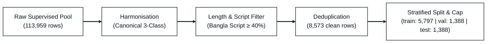

# Dataset Directory & Source Provenance

> **Role in Project:** Comprehensive data acquisition, linguistic resource mining, and sentiment label harmonisation for fine-tuning Bangla BERT models.  
> **Primary Script:** `src/download_datasets.py` &bull; `src/preprocess.py`  
> **Interactive Notebook:** [`notebooks/01_data_preprocessing.ipynb`](https://colab.research.google.com/github/ShoumikBalaSomu/Developing-a-Bangla-Sentiment-Analysis-System-Using-Fine-Tuned-BERT-Models/blob/main/notebooks/01_data_preprocessing.ipynb)  
> **Dataset Card:** See [`dataset_card.md`](dataset_card.md) for full metadata, licensing, and ethical disclosures.

---

## 1. Upstream Kaggle & Hugging Face Datasets

Six datasets drive this research system. Three are auxiliary linguistic resources (which contain no sentiment labels on their own), and three are supervised sentiment corpora:

### 1.1 Auxiliary Linguistic Resources (Grammar, Lexicons, & Literature)

| Dataset | Kaggle Repository Link | Hugging Face Mirror | Size / Rows | Role in System | Kaggle Auth |
|---|---|---|:---:|---|:---:|
| **BanglaGEC** | [**`nahidhub/banglagec`**](https://www.kaggle.com/datasets/nahidhub/banglagec) | [`nahid-hub/BanglaGEC`](https://huggingface.co/datasets/nahid-hub/BanglaGEC) | ~7.07M sentence pairs | **Grammar-rule mining.** Mined 2,238 source&rarr;target substitution rules (support &ge; 5) to clean noisy social text (+2.17% Macro-F1 boost). Target column builds well-formed vocabulary (96,383 types). | Public on HF |
| **Bangla NLP Words** | [**`saifsunny/bangla-nlp-words`**](https://www.kaggle.com/datasets/saifsunny/bangla-nlp-words) | — | 76,293 entries | **Negation lexicon & stopwords.** Supplies the 14-negator list for syntactic `NEG_` scope tagging and 813 Bangla stopwords. | Yes |
| **Bangla NLP Catalog** | [**`kishormorol/bangla-nlp-catalog`**](https://www.kaggle.com/datasets/kishormorol/bangla-nlp-catalog) | [`kishormorol/bangla-nlp-catalog`](https://huggingface.co/datasets/kishormorol/bangla-nlp-catalog) | 905 papers & datasets | **Literature review generator.** Filtered by `src/catalog_to_lr.py` (166 sentiment papers captured) to produce `docs/02_literature_review.md`. | Public on HF |

### 1.2 Supervised Sentiment Corpora (Supervision)

| Dataset | Kaggle Repository Link | Raw Rows | Original Label Scheme | Harmonised Classes | Kaggle Auth |
|---|---|:---:|---|---|:---:|
| **RevBangla** | [**`saifsunny/revbangla`**](https://www.kaggle.com/datasets/saifsunny/revbangla) | 5,015 | `Label_Sentiment` (positive / negative) | Negative (0), Positive (2) | Yes |
| **Bangladesh Daraz Reviews** | [**`robiulhasanjisan/bangladesh-daraz-reviews-for-sentiment-analysis`**](https://www.kaggle.com/datasets/robiulhasanjisan/bangladesh-daraz-reviews-for-sentiment-analysis) | 8,944 | `rating` (1 to 5 star ratings) | 1-2 &rarr; Neg, 3 &rarr; Neu, 4-5 &rarr; Pos | Yes |
| **Large Sentiment Analysis Bangla** | [**`tahmidmir/largesentimentdata`**](https://www.kaggle.com/datasets/tahmidmir/largesentimentdata) | 100,000 | `Sentiment` (positive / negative / neutral) | Negative (0), Neutral (1), Positive (2) | Yes |

---

## 2. Setting Up Kaggle Credentials & Downloading

### 2.1 Generating Kaggle API Token
1. Go to [kaggle.com](https://www.kaggle.com) &rarr; Click your avatar &rarr; **Settings**.
2. Scroll to the **API** section and click **Create New Token**.
3. A file named `kaggle.json` will download.
4. Place `kaggle.json` in:
   - **Linux / macOS:** `~/.kaggle/kaggle.json`
   - **Windows:** `C:\Users\<username>\.kaggle\kaggle.json`
5. Set permissions (Linux/macOS): `chmod 600 ~/.kaggle/kaggle.json`

### 2.2 Automated Acquisition via Project Pipeline
To download and extract all datasets into `dataset/raw/`:

```bash
# Automated fetcher using Kaggle API + Hugging Face Hub:
python src/download_datasets.py --max-rows 200000

# Or run without Kaggle credentials (downloads public HF mirrors only):
python src/download_datasets.py --skip-kaggle
```

### 2.3 Manual Download via Kaggle CLI
If you prefer downloading individual datasets manually:

```bash
# Auxiliary Resources:
kaggle datasets download -d nahidhub/banglagec -p dataset/raw/banglagec --unzip
kaggle datasets download -d saifsunny/bangla-nlp-words -p dataset/raw/bangla_nlp_words --unzip
kaggle datasets download -d kishormorol/bangla-nlp-catalog -p dataset/raw/bangla_nlp_catalog --unzip

# Supervised Corpora:
kaggle datasets download -d saifsunny/revbangla -p dataset/raw/revbangla --unzip
kaggle datasets download -d robiulhasanjisan/bangladesh-daraz-reviews-for-sentiment-analysis -p dataset/raw/daraz_bd --unzip
kaggle datasets download -d tahmidmir/largesentimentdata -p dataset/raw/largesentiment --unzip
```

---

## 3. Preprocessing, Harmonisation & Splitting Pipeline

Executed by `src/preprocess.py` or **Notebook 01** (`notebooks/01_data_preprocessing.ipynb`):



### 3.1 Supervised Pool Attrition

| Stage | Rows Remaining | Dropped | Drop Rationale |
|---|:---:|:---:|---|
| **Raw Supervised Pool** | 113,959 | — | Combined Daraz + RevBangla + LargeSentiment |
| **After Label Harmonisation** | 113,959 | 0 | All source labels mapped to `{negative, neutral, positive}` |
| **After Length Filter** | 113,227 | 732 | Text length < 3 or > 1,000 characters |
| **After Script Filter** | 108,795 | 4,432 | Bangla character ratio < 0.40 (filtered pure English spam) |
| **After Deduplication** | **8,573** | 100,222 | Exact duplicate text (LargeSentiment had ~20 unique comments repeated) |

### 3.2 Partition Distribution & Majority Class Cap
- **Stratification:** Split on `(label, source)` jointly to guarantee zero platform domain leakage.
- **Majority Class Cap:** Training positive majority class capped at 60% (3,883 rows) to prevent minority class collapse.
- **Leakage Guard:** Train/Test overlap is **0**, and Train/Val overlap is **0**.

| Partition | Total Rows | Negative (0) | Neutral (1) | Positive (2) | Share of Pool |
|---|:---:|:---:|:---:|:---:|:---:|
| **Train** | **5,797** | 1,816 (31.3%) | 98 (1.7%) | 3,883 (67.0%) | 70% |
| **Validation** | **1,388** | 389 (28.0%) | 22 (1.6%) | 977 (70.4%) | 15% |
| **Test** | **1,388** | 389 (28.0%) | 21 (1.5%) | 978 (70.5%) | 15% |

---

## 4. Directory Layout & Generated Artifacts

```
dataset/
├── README.md                          ← This guide with Kaggle links & specifications
├── dataset_card.md                    ← Academic metadata card, provenance, & ethical disclosures
│
├── raw/                               ← Downloaded raw datasets (git-ignored)
│   ├── banglagec/                     ← nahidhub/banglagec (test.csv, train.csv, val.csv)
│   ├── bangla_nlp_words/              ← saifsunny/bangla-nlp-words (stopwords, words.csv)
│   ├── bangla_nlp_catalog/            ← kishormorol/bangla-nlp-catalog (catalog.csv)
│   ├── revbangla/                     ← saifsunny/revbangla (data.csv)
│   ├── daraz_bd/                      ← robiulhasanjisan/bangladesh-daraz-reviews (reviews.csv)
│   └── largesentiment/                ← tahmidmir/largesentimentdata (dataset.csv)
│
└── preprocessed/                      ← Pipeline outputs (reproducible via seed 42)
    ├── train_clean.csv                ← 5,797 training rows
    ├── val_clean.csv                  ← 1,388 validation rows
    ├── test_clean.csv                 ← 1,388 test rows
    ├── grammar_rules.csv              ← 2,238 mined BanglaGEC substitution rules
    ├── negation_lexicon.txt           ← 14-negator lexicon for syntactic scope tagging
    ├── bangla_stopwords.txt           ← 813 curated Bangla stopwords
    ├── wellformed_vocab.txt           ← 96,383 well-formed Bangla vocabulary tokens
    ├── literature_review_table.csv    ← 166 sentiment catalog entries
    ├── lr_task_frequency.csv          ← NLP catalog task breakdown
    └── data_manifest.csv              ← SHA-256 cryptographic reproducibility record (committed)
```

---

## 5. Cryptographic Reproducibility Manifest

From [`dataset/preprocessed/data_manifest.csv`](preprocessed/data_manifest.csv):

| Artifact | File Name | Size (Bytes) | SHA-256 Checksum |
|---|---|:---:|---|
| `clean_train` | `train_clean.csv` | 2,528,461 | `39f2df731b5b551bf7270744e6efc436c01e0a427d11d17f9a7433440f972a77` |
| `clean_val` | `val_clean.csv` | 592,350 | `ca1794aadc6a5a68a489326b800ff80e0336312066aa01f0bd7cdbfd46449af3` |
| `clean_test` | `test_clean.csv` | 586,114 | `c81b3cc200c4ae66a18c0ad49c0cc296f4d660814376dfb02a2088ecd0da776b` |
| `grammar_rules` | `grammar_rules.csv` | 546,214 | `41d4f9190b870bf5b316b410ca1d07014f9e0eece2b94509f4cf1d62ecfa5ebe` |
| `negation_lexicon`| `negation_lexicon.txt` | 178 | `d453b5f3fda0c30753bdb30aef921d0f8e907103d7e101e346b9de3b97c39072` |
| `stopwords` | `bangla_stopwords.txt` | 12,573 | `bfdc94c204ad6e26f99635529d3c05ccb139fb90b65635427b938a097532bcf1` |
| `vocab_wellformed`| `wellformed_vocab.txt` | 2,383,465 | `1b26dda73da67b41c806036bccc8a5508d2ba4a9e2e8f3a1bab123f353cd577a` |
| `lr_table` | `literature_review_table.csv` | 55,619 | `eac3f2e2a4a147c082876361ef93cc3c09b2405f550be4c4c85e8ac5042e3582` |

---

## 6. End-to-End Pipeline Execution

To regenerate all preprocessed artifacts and verify the manifest:

```bash
# 1. Acquire datasets from Kaggle & Hugging Face
python src/download_datasets.py --max-rows 200000

# 2. Mine grammar rules, build lexicons, clean, and split
python src/preprocess.py --sample 200000

# 3. Generate literature review catalog table
python src/catalog_to_lr.py --top 40
```
