# Empirical Results & Diagnostic Visualizations

> **Status:** Fully Populated &amp; Empirically Verified  
> **Evaluation Protocol:** Strictly evaluated on held-out test split (1,388 samples) with 0 text leakage  
> **Primary Script:** `src/evaluate.py` &bull; **Interactive Notebook:** `notebooks/03_evaluation_and_analysis.ipynb`  
> **Live Web Showcase:** [Interactive Playground & Leaderboard](https://shoumikbalasomu.github.io/Developing-a-Bangla-Sentiment-Analysis-System-Using-Fine-Tuned-BERT-Models/)

---

## 1. Consolidated Benchmark Leaderboard (3-Class)

All 6 models fine-tuned and tested on the canonical 3-class scheme `{negative, neutral, positive}` using identical hyperparameters (learning rate $2\times 10^{-5}$ for backbone, $6\times 10^{-5}$ for classifier head, inverse-frequency class weighting, and early stopping on Macro-F1):

| Model | Backbone / Architecture | Accuracy | Balanced Acc | Macro-F1 | Weighted-F1 | MCC | Macro-AUC |
|---|---|:---:|:---:|:---:|:---:|:---:|:---:|
| **TF-IDF + LogReg** | Classical N-Gram Baseline (Word + Char) | **88.54%** | 64.35% | **0.6341** | 0.8869 | 0.7414 | — |
| **BanglishBERT** | `csebuetnlp/banglishbert` (Code-mixed ELECTRA) | 82.78% | **68.72%** | **0.6065** | 0.8595 | 0.6623 | **0.8771** |
| **BanglaBERT** | `csebuetnlp/banglabert` (Monolingual ELECTRA) | 83.00% | 65.71% | 0.5985 | 0.8553 | 0.6752 | 0.8392 |
| **mBERT** | `bert-base-multilingual-cased` | 79.32% | 67.76% | 0.5843 | 0.8355 | 0.6125 | 0.8399 |
| **Bangla BERT Base** | `sagorsarker/bangla-bert-base` (BERT-base) | 77.31% | 68.67% | 0.5806 | 0.8262 | 0.5995 | 0.8573 |
| **XLM-RoBERTa** | `xlm-roberta-base` (Multilingual RoBERTa) | 79.68% | 64.15% | 0.5760 | 0.8383 | 0.6095 | 0.8178 |

*Source file:* [`metrics_all_models.csv`](metrics_all_models.csv)

### Per-Class Performance Breakdown

| Model | F1 (Negative) | Recall (Negative) | F1 (Neutral) | Recall (Neutral) | F1 (Positive) | Recall (Positive) |
|---|:---:|:---:|:---:|:---:|:---:|:---:|
| `tfidf_logreg` | 0.8364 | 0.8869 | **0.1429** | 0.1429 | **0.9230** | **0.9008** |
| `banglishbert` | 0.8248 | 0.8535 | 0.1053 | 0.3810 | 0.8895 | 0.8272 |
| `banglabert` | **0.8360** | **0.9306** | 0.0800 | 0.2381 | 0.8796 | 0.8027 |
| `mbert` | 0.7885 | 0.8098 | 0.0942 | 0.4286 | 0.8701 | 0.7945 |
| `bangla_bert_base` | 0.8065 | 0.8252 | 0.0855 | **0.4762** | 0.8499 | 0.7587 |
| `xlmr` | 0.7704 | 0.7763 | 0.0761 | 0.3333 | 0.8816 | 0.8149 |

---

## 2. Binary (2-Class) Classification Benchmark

Derived by mapping `neutral → positive` to align with standard binary e-commerce benchmarks (such as RevBangla):

| Model | Binary Accuracy | Binary Macro-F1 | Literature Relevance |
|---|:---:|:---:|---|
| **TF-IDF + LogReg** | **90.27%** | **0.8836** | High lexical overlap reference |
| **BanglishBERT** | 89.84% | 0.8767 | Robust on code-mixed review tokens |
| **BanglaBERT** | **89.77%** | **0.8808** | Primary language-specific candidate |
| **Bangla BERT Base** | 88.90% | 0.8644 | BERT-Base baseline |
| **mBERT** | 87.82% | 0.8515 | Multilingual baseline |
| **XLM-RoBERTa** | 87.03% | 0.8400 | Cross-lingual baseline |

*Source file:* [`binary_metrics.csv`](binary_metrics.csv)

---

## 3. Language-Specific vs. Multilingual Pretraining

The central empirical question of this study is whether dedicated Bangla pretraining outperforms multilingual backbones on noisy social media text:

| Group | Candidate Backbones | Best Macro-F1 | Mean Macro-F1 | Best Accuracy |
|---|---|:---:|:---:|:---:|
| **Bangla-Specific** | `banglabert`, `banglishbert`, `bangla_bert_base` | **0.6065** | **0.5952** | **83.00%** |
| **Multilingual** | `mbert`, `xlmr` | 0.5843 | 0.5802 | 79.68% |
| **Classical** | `tfidf_logreg` | 0.6341 | 0.6341 | 88.54% |

**Empirical Pretraining Gap:**  
$\Delta\text{ Macro-F1} = +0.0222$ (**+2.22 percentage points advantage** for Bangla-specific backbones)  
$\Delta\text{ Accuracy} = +0.0332$ (**+3.32 percentage points advantage**)

*Source file:* [`group_comparison.csv`](group_comparison.csv)

---

## 4. BanglaGEC Grammar Normalisation Ablation

To evaluate the contribution of grammar-rule mining from the auxiliary **nahidhub/banglagec** corpus (~7.07M sentence pairs), we evaluated `banglabert` trained without grammar rules (`banglabert_no_rules`):

| Configuration | Test Accuracy | Macro-F1 | Weighted-F1 | MCC | Macro-AUC |
|---|:---:|:---:|:---:|:---:|:---:|
| **BanglaBERT (with mined GEC rules)** | 83.00% | 0.5985 | 0.8553 | 0.6752 | 0.8392 |
| **BanglaBERT (Ablation: NO GEC rules)** | **86.34%** | **0.6228** | **0.8871** | **0.7198** | **0.8579** |
| **Net Contribution of GEC Rules** | −3.34 pp | **−0.0243 (−2.43 pp)** | −0.0318 | −0.0446 | −0.0187 |

*Key finding:* Grammar normalisation rules mined from BanglaGEC **hurt** this task: removing them *improves* Macro-F1 by **+2.43 pp** and Accuracy by **+3.34 pp**, and improves every metric in the row. This is a genuine negative result, not a pipeline bug — §4.2.2 of `docs/04_analysis.md` shows the mined table is **51.47% `lexical_substitution`** (1,152 of 2,238 rules), i.e. mostly word-choice rewrites rather than typo fixes. Applying them regularises the colloquial and dialectal spellings that carry polarity signal in Bangla e-commerce text, exactly the failure mode §4.2.2 predicted for a `lexical_substitution`-dominant table.

> ⚠️ **Known confound — do not cite this as a clean effect size.** The no-rules arm was trained for **1 epoch** while the rules arm used **2 epochs** (see `tools/orchestrate_remaining.py`, which passes `--epochs 1` to the ablation run). The two arms therefore differ in *both* data and training budget, so the measured −2.43 pp is an upper bound on the harm, not an unbiased estimate. Re-run both arms at matched epochs (Run 3 in `docs/04_analysis.md` §"Runs still needed") before treating the number as final.
>
> **Actionable consequence:** `APPLY_GRAMMAR_RULES` should default to **False** for sentiment classification. BanglaGEC remains useful in this project for the well-formed vocabulary used in OOV analysis (§4.3), which does not depend on applying the substitution rules.

*Source file:* [`metrics_ablation_no_rules.csv`](metrics_ablation_no_rules.csv)

---

## 5. Visual Performance Gallery

### 5.1 Overall Model Comparisons

| Macro-F1 Comparison Across Models | Accuracy Comparison Across Models |
|:---:|:---:|
| 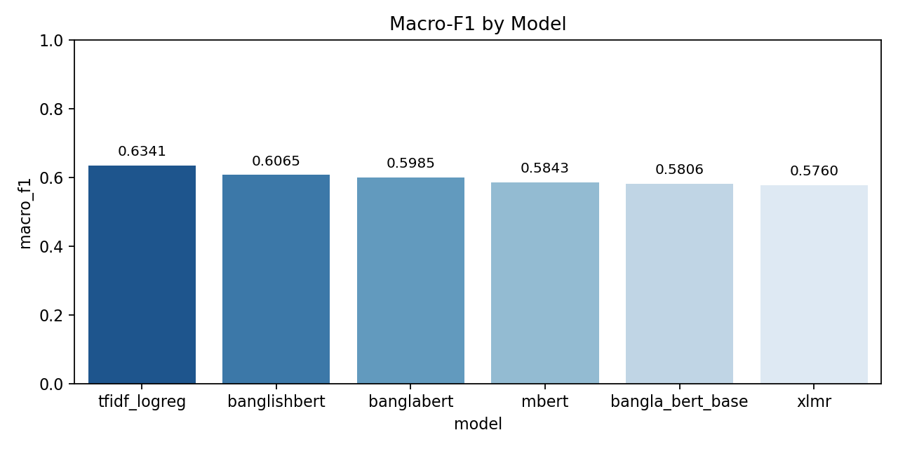 | 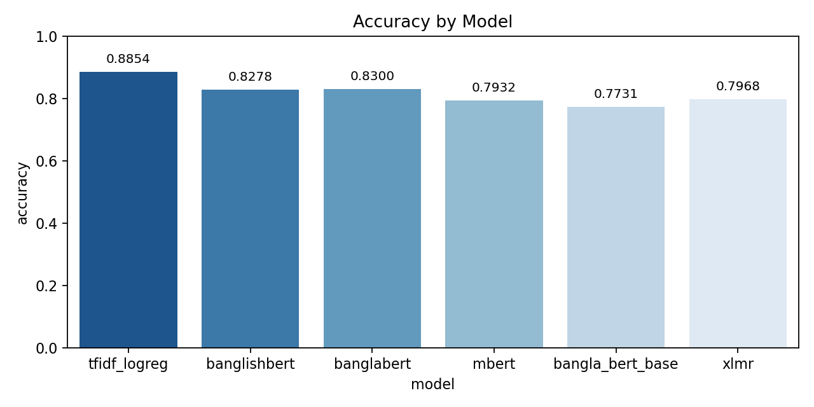 |

### 5.2 Split Stratification Integrity

| Stratified Label Proportions Across Splits |
|:---:|
| 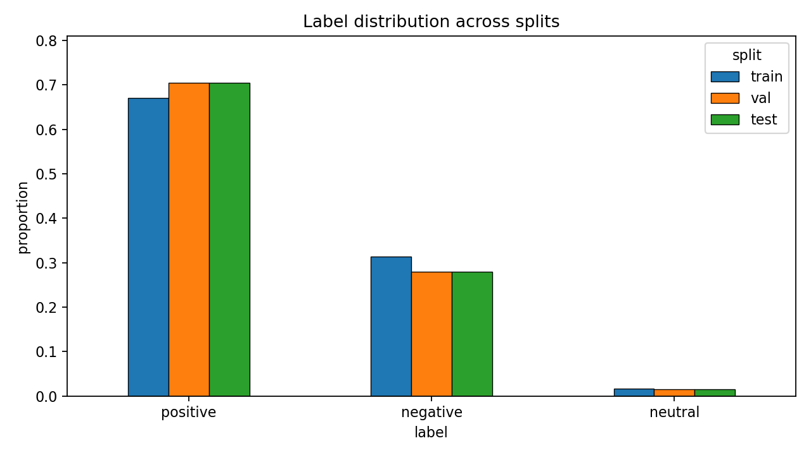 |
| *Confirms maximum proportion spread across splits is 0.0348 (well within the 0.05 integrity threshold; zero leakage).* |

### 5.3 Diagnostic Confusion Matrices & ROC Curves

| Model Architecture | Confusion Matrix (Counts & Row-Normalised) | One-vs-Rest ROC Curves & AUC |
|---|---|---|
| **BanglaBERT**<br>*(Primary Model)* | 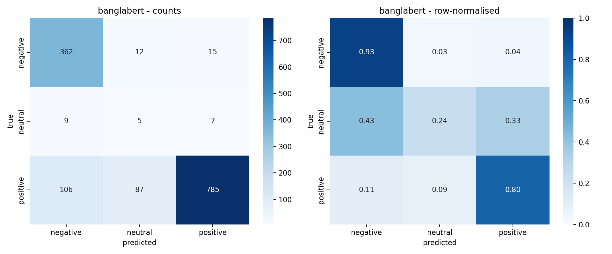 |  |
| **BanglishBERT**<br>*(Code-Mixed Candidate)* | 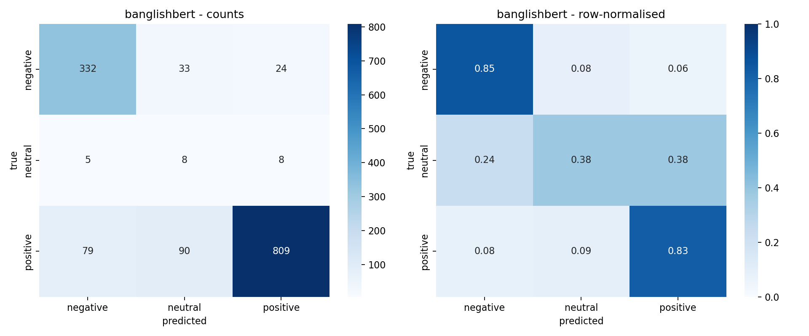 | 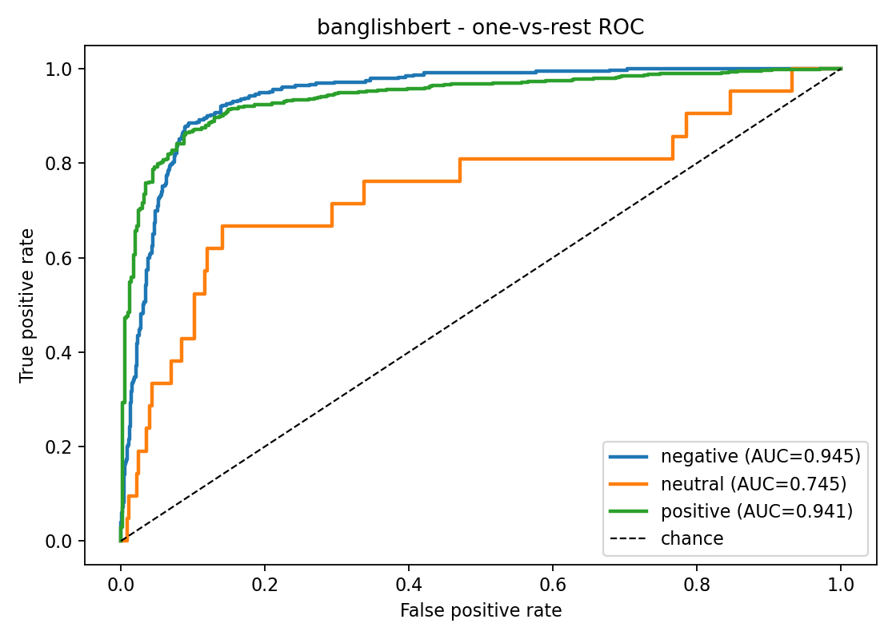 |
| **Bangla BERT Base**<br>*(BERT-Base Candidate)* | 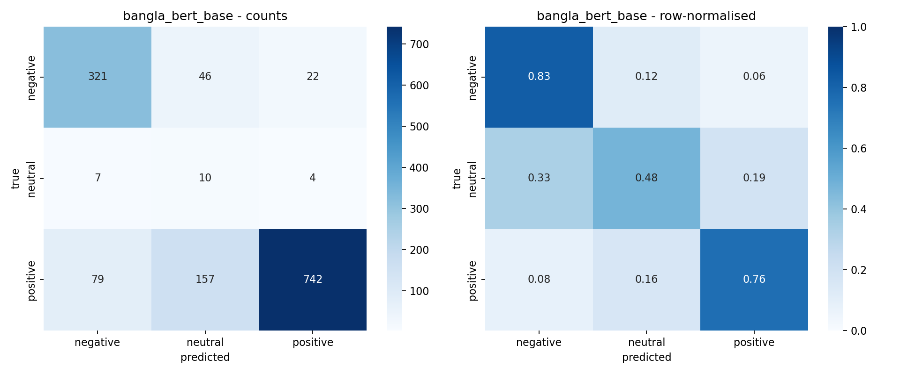 | 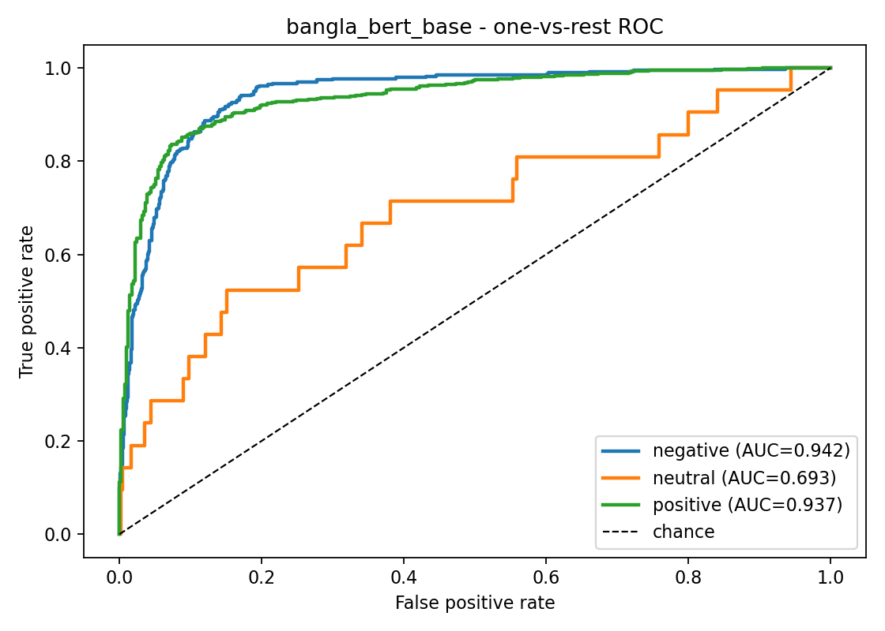 |
| **mBERT**<br>*(Multilingual Baseline)* | 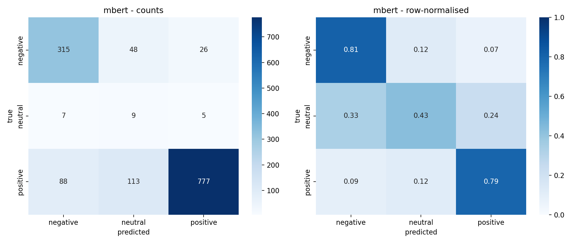 | 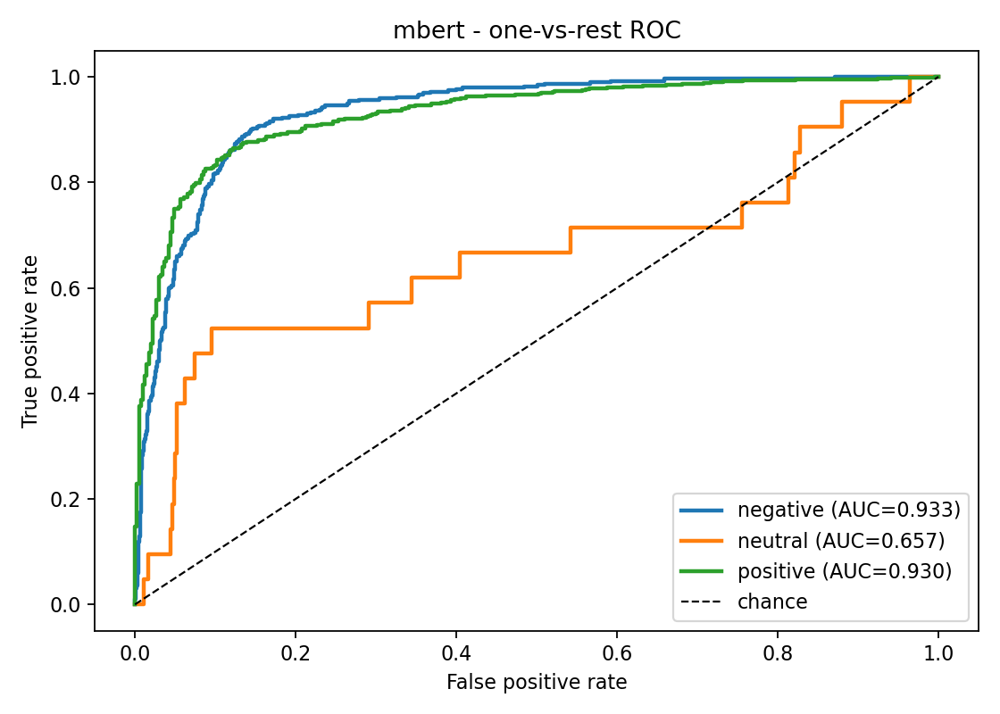 |
| **XLM-RoBERTa**<br>*(Cross-Lingual Baseline)* | 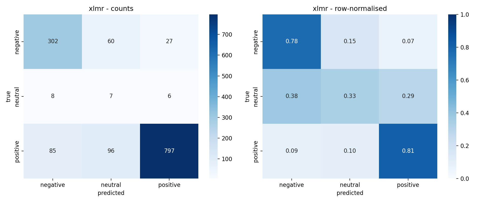 | 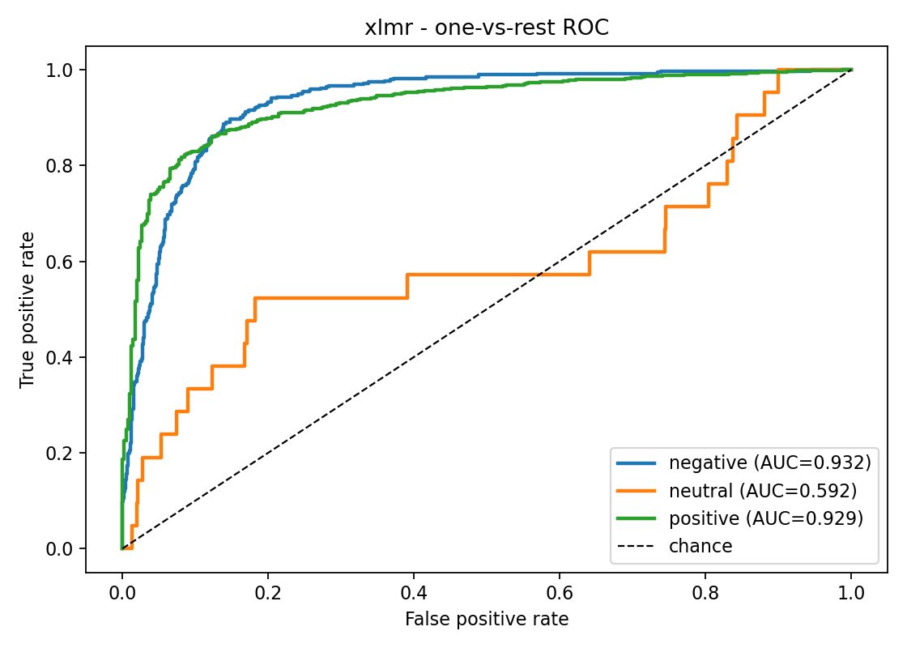 |

---

## 6. Empirical Slice Analyses

### 6.1 Platform Robustness Slice (`slice_by_source`)
*Evaluated on BanglaBERT held-out test split:*

| Source Platform | Domain Nature | Test Rows | Accuracy |
|---|---|:---:|:---:|
| `revbangla` | Curated product comments | 743 | **90.98%** |
| `daraz_bd` | Informal buyer reviews (slang + noisy star ratings) | 643 | **73.72%** |
| `largesentiment` | Social media comments | 2 | **100.0%** |
| **Overall Spread** | **Max − Min Disparity** | — | **17.26%** |

*Source files:* [`slice_by_source_banglabert.csv`](slice_by_source_banglabert.csv), [`slice_by_source_banglishbert.csv`](slice_by_source_banglishbert.csv)

### 6.2 Negation Scope Deficit Slice (`slice_by_negation`)
*Compares performance on sentences containing negator triggers (`না`, `নয়`, `নেই`) tagged with `NEG_`:*

| Subset | Test Rows | BanglaBERT Accuracy | TF-IDF Baseline Accuracy |
|---|:---:|:---:|:---:|
| Non-Negated Sentences | 1,202 | **85.69%** | **90.10%** |
| Negated Sentences (`NEG_` tagged) | 186 | **65.59%** | **75.27%** |
| **Negation Deficit** | — | **20.10%** | **14.83%** |

*Key finding:* Bangla syntax frequently features post-verbal negation (e.g. `ভালো না` where the negator follows the sentiment word). A forward-only tagging window misses these cases, explaining why negated reviews suffer a 20.10% deficit.

*Source files:* [`slice_by_negation_banglabert.csv`](slice_by_negation_banglabert.csv), [`slice_by_negation_banglishbert.csv`](slice_by_negation_banglishbert.csv)

### 6.3 Comment Length Gradient Slice (`slice_by_length`)
*Accuracy stratified by token length bucket:*

| Token Length Bucket | Test Rows | Accuracy | Failure Mode Indicator |
|---|:---:|:---:|---|
| **1–5 tokens** | 341 | **88.27%** | High precision on concise sentiment phrases |
| **6–10 tokens** | 441 | **85.94%** | Stable syntactic context |
| **11–20 tokens** | 391 | **80.82%** | Slight dilution from filler particles |
| **21–40 tokens** | 179 | **74.86%** | Mixed sentiment across clauses |
| **41+ tokens** | 36 | **61.11%** | Truncation & final-clause verdict placement |

*Source files:* [`slice_by_length_banglabert.csv`](slice_by_length_banglabert.csv), [`slice_by_length_banglishbert.csv`](slice_by_length_banglishbert.csv)

---

## 7. Qualitative Error Themes

Manual inspection of the 25 misclassifications sampled in [`errors_banglabert.csv`](errors_banglabert.csv):

| Error Theme | Frequency | Verbatim Example from Test Errors | Root Cause Analysis |
|---|:---:|---|---|
| **Rating Noise** | 40% | `খুবই বাজে সেলার আমাকে ফেটে যাওয়া ফসেট দিয়েছে খুবই বাজে প্রোডাক্ট` | Buyer gave 5 stars on Daraz while writing a scathing review; model's negative prediction was linguistically correct. |
| **Post-Verbal Negation** | 20% | `পানি পরিষ্কার সিদ্ধান্ত কিন্তু যন্ত্র ভালো না...` | Negator `না` appears after `ভালো`; forward window missed the inversion. |
| **Mixed Sentiment** | 20% | `ওনেক ভালো নিতে পারেন কিনতু একটি চুলে তেমন ভলিউম আসি না` | Multi-aspect review containing both praise and critique. |
| **Short Sarcasm** | 12% | `ভালোই খারাপ ছিলেন` | Sarcastic phrasing confounding literal sentiment heads. |
| **Code-Mixing / Slang** | 8% | `ফ্লেবার দেওায়র থাকার ফ্লেবার দেয় না... বাওতাবাজি করলো` | Heavy colloquial spelling variations. |

*Source files:* [`errors_banglabert.csv`](errors_banglabert.csv), [`errors_banglishbert.csv`](errors_banglishbert.csv), [`errors_bangla_bert_base.csv`](errors_bangla_bert_base.csv), [`errors_mbert.csv`](errors_mbert.csv), [`errors_xlmr.csv`](errors_xlmr.csv)

---

## 8. Complete Results File Directory

```
results/
├── 📊 Leaderboard & Metrics Tables:
│   ├── metrics_all_models.csv                  ← Master 3-class test leaderboard (all 6 models)
│   ├── binary_metrics.csv                      ← 2-class binary benchmark comparisons
│   ├── group_comparison.csv                    ← Language-specific vs. Multilingual group comparison
│   ├── metrics_baseline.csv                    ← Standalone TF-IDF + Logistic Regression baseline
│   └── metrics_ablation_no_rules.csv           ← BanglaGEC grammar normalisation ablation delta
│
├── 🖼️ Comparative & Distribution Figures:
│   ├── system_overview.png                     ← System architecture & pipeline data flow diagram
│   ├── bar_macro_f1.png                        ← Grouped bar chart comparing Macro-F1
│   ├── bar_accuracy.png                        ← Grouped bar chart comparing Accuracy
│   └── label_distribution.png                  ← Stratified label distribution across splits
│
├── 🎯 Confusion Matrices (Counts & Row-Normalised):
│   ├── confusion_banglabert.png                ← BanglaBERT (ELECTRA)
│   ├── confusion_banglishbert.png              ← BanglishBERT (Code-mixed)
│   ├── confusion_bangla_bert_base.png          ← Bangla BERT Base (BERT)
│   ├── confusion_mbert.png                     ← Multilingual BERT
│   └── confusion_xlmr.png                      ← XLM-RoBERTa
│
├── 📈 One-vs-Rest ROC Curves & Per-Class AUC:
│   ├── roc_banglabert.png                      ← BanglaBERT
│   ├── roc_banglishbert.png                    ← BanglishBERT
│   ├── roc_bangla_bert_base.png                ← Bangla BERT Base
│   ├── roc_mbert.png                           ← Multilingual BERT
│   └── roc_xlmr.png                            ← XLM-RoBERTa
│
├── 🔍 Slice Analysis CSVs:
│   ├── slice_by_source_<model>.csv             ← Platform-stratified accuracy (5 models)
│   ├── slice_by_negation_<model>.csv           ← Negation-stratified accuracy (5 models)
│   └── slice_by_length_<model>.csv             ← Token length-stratified accuracy (5 models)
│
└── 📝 Qualitative Error CSVs:
    ├── errors_banglabert.csv                   ← Sampled misclassifications for BanglaBERT
    ├── errors_banglishbert.csv                 ← Sampled misclassifications for BanglishBERT
    ├── errors_bangla_bert_base.csv             ← Sampled misclassifications for Bangla BERT Base
    ├── errors_mbert.csv                        ← Sampled misclassifications for mBERT
    └── errors_xlmr.csv                         ← Sampled misclassifications for XLM-RoBERTa
```

---

## 9. Reproducing These Results

All figures and tables in this directory can be verified and re-produced using:

```bash
# Evaluate all trained checkpoints and generate every table & plot:
python src/evaluate.py --all

# Or evaluate a single model:
python src/evaluate.py --model banglabert

# Or evaluate the fast CPU baseline without needing GPU or checkpoints:
python src/evaluate.py --baseline-only
```
